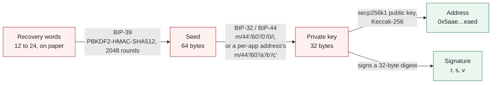
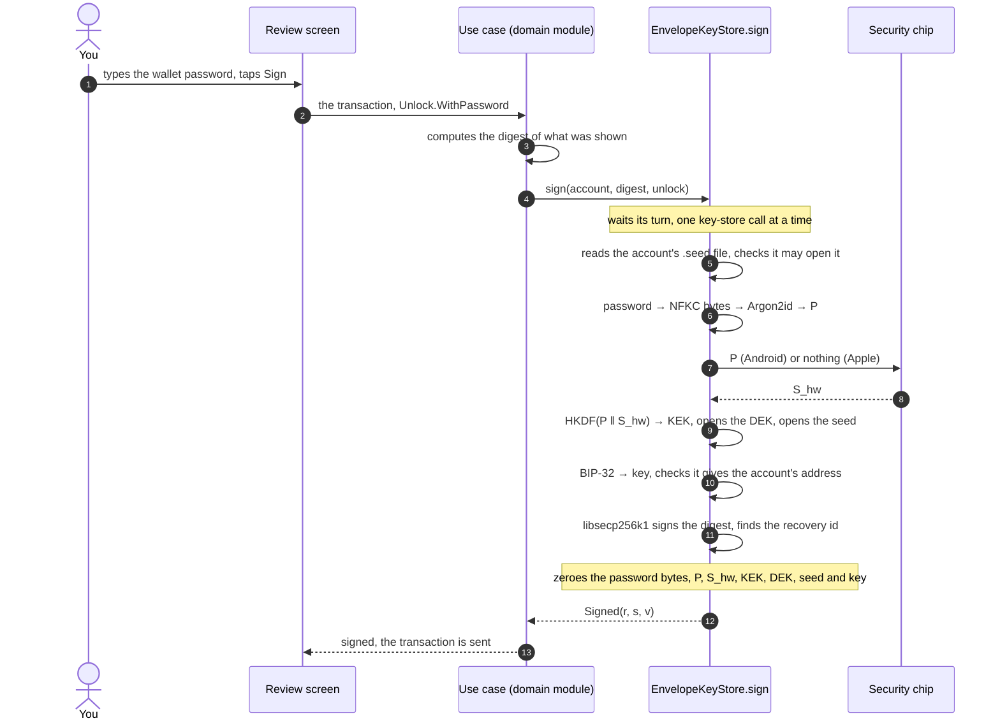
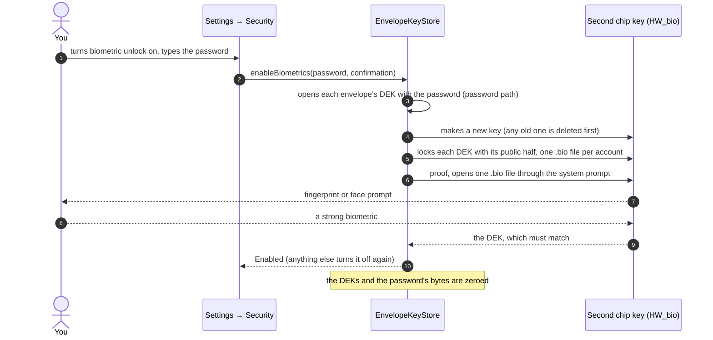
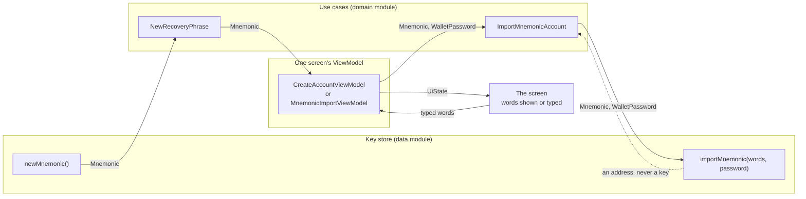

# How Punicus protects your keys

This page explains how Punicus keeps the secret behind your accounts: what
is secret, where it is kept, what protects it on each platform, why it has
to be decrypted for a moment to sign, and what all of this does not protect
against.

Each section starts in plain words. Under them, folded blocks marked
**Show the code** quote the code that does it, so that anyone who wants to
can check each claim against the repository. The last section,
[*Check it yourself*](#15-check-it-yourself), maps every claim to its code
and to the test that holds it.

> **The contract is [docs/keys-and-signing.md](keys-and-signing.md).** This
> page explains it; it does not change it. Where the two differ, the
> contract wins and this page is fixed. The code is quoted as it stands on
> `main` at `49161702` (2026-11-14), with the per-app addresses of #252
> (`feature/per-app-addresses`, 2026-11-18). Comments are trimmed, and
> `// …` marks lines left out.

## Contents

- [The short version](#the-short-version)
- [Words used on this page](#words-used-on-this-page)
- [1. What is secret](#1-what-is-secret)
- [2. Why the security chip cannot hold the key itself](#2-why-the-security-chip-cannot-hold-the-key-itself)
- [3. The envelope](#3-the-envelope)
- [4. Stretching the password](#4-stretching-the-password)
- [5. The hardware secret, platform by platform](#5-the-hardware-secret-platform-by-platform)
- [6. Signing: the moment the key exists](#6-signing-the-moment-the-key-exists)
- [7. Fingerprint and face unlock](#7-fingerprint-and-face-unlock)
- [8. Creating and restoring: the words on screen](#8-creating-and-restoring-the-words-on-screen)
- [9. Keeping the screen private](#9-keeping-the-screen-private)
- [10. The files, backups and transfers](#10-the-files-backups-and-transfers)
- [11. Removing an account deletes its key](#11-removing-an-account-deletes-its-key)
- [12. What this protects against, and what it does not](#12-what-this-protects-against-and-what-it-does-not)
- [13. Other sensitive things the app keeps](#13-other-sensitive-things-the-app-keeps)
- [14. Not built yet](#14-not-built-yet)
- [15. Check it yourself](#15-check-it-yourself)

## The short version


- **Your recovery phrase is the master secret.** Its twelve (or up to
  twenty-four) words make a *seed*, and the seed makes the private keys of
  your accounts. Whoever has the words, the seed or a key can move the
  funds.
- **Punicus stores the seed, never in the clear.** Each account has one file,
  its *envelope*, in which the seed is encrypted. The words themselves are
  not stored at all.
- **Opening an envelope takes two things at once**: your wallet password
  AND a secret that only this device's security chip can produce. Neither
  alone is enough, and a copy of the file is useless on any other device.
  Windows and Linux are the exception for now: there, the password alone
  protects the file, and the app says so.
- **The chip cannot sign for Ethereum.** Ethereum signatures use a kind of
  math (the *secp256k1* curve) that no phone or computer chip offers. So
  when you sign, the seed is decrypted inside the app for the length of one
  function call, the signature is made, and every copy the code holds is
  overwritten with zeros before the call returns.
- **Fingerprint or face unlock is optional.** Turned on, it adds a second
  chip key that works only after a fresh fingerprint or face. The password
  keeps working, and turning biometrics off deletes that key.
- **The envelopes never leave the device**: not in a cloud backup, not in a
  transfer to a new phone. The recovery phrase you wrote down is the only
  backup.
- **The screens that show the words or take the password** block
  screenshots and screen recording on Android. On an iPhone, where no app
  can block them, the app hides itself in the app switcher and warns you
  when a screenshot is taken. On a computer nothing can block them, and the
  screen says so.
- **What it does not do**: it cannot stop malware that has taken over the
  app while you use it, it cannot make a weak password strong where no chip
  is used, and it cannot prove that what you approved is what was signed.
  It does not yet keep recovery words you copy off the clipboard.
  [Section 12](#12-what-this-protects-against-and-what-it-does-not) goes
  through each case.

## Words used on this page

| Word | Meaning |
|---|---|
| **Recovery phrase**, mnemonic | The 12 to 24 words from a fixed list of 2048 (BIP-39). They encode random bits plus a checksum. |
| **Seed** | 64 bytes computed from the words. Every key of the phrase comes from it. |
| **Private key** | 32 bytes that sign for one account. Derived from the seed along a path such as `m/44'/60'/0'/0/0`. |
| **Address** | The public name of an account, computed from its key. Safe to share. |
| **Digest** | The 32-byte fingerprint of a transaction or message. A signature is made over a digest. |
| **secp256k1** | The elliptic curve Ethereum signs with. |
| **Security chip**, secure hardware | A separate processor, or a protected mode of the main one, that keeps keys the operating system cannot read: Android's **TEE** (Trusted Execution Environment) or **StrongBox** (a separate secure element), Apple's **Secure Enclave**, a PC's **TPM**. |
| **Envelope** | The file that holds one account's seed, encrypted (section 3). |
| **DEK**, data-encryption key | A random key that encrypts the seed. |
| **KEK**, key-encryption key | The key that encrypts the DEK. It is computed from the password and the hardware secret at each unlock and never stored. |
| `P` | The password after stretching (section 4). |
| `S_hw` | The hardware secret: what the chip contributes (section 5). |
| **Argon2id** | A function that turns a password into a key slowly, using a lot of memory, so that guessing costs time and memory. |
| **AES-256-GCM** | The cipher that encrypts the DEK and the seed. It also detects any change to the ciphertext. |
| **AAD**, additional authenticated data | Plain data glued to a ciphertext: it is not encrypted, but changing it makes decryption fail. |
| **HKDF**, **HMAC** | Standard ways to derive a key from other keys (HKDF) and to compute a keyed fingerprint (HMAC). |
| **ECIES** | Encrypting to an elliptic-curve public key. Apple's Secure Enclave uses it to encrypt and decrypt. |
| **Zeroing** | Overwriting the bytes of a secret with zeros once it is no longer needed. |

## 1. What is secret

An account is controlled by its private key. The key comes from the seed,
and the seed comes from the recovery words:



Red is secret, green is public. Every arrow goes one way: an address does
not reveal its key, and a key does not reveal the seed.

**What Punicus stores is the seed**, encrypted, one envelope per account.
It does not store the words: they are shown once when an account is
created, and typed once when one is restored (section 8). It stores the
seed rather than the key so that further accounts of the same phrase can be
added without typing the words again (owner ruling, 2026-10-15). Each such
account gets an envelope of its own, holding the same seed and naming its
index on the path. So does each per-app address (#252): every site a dApp
connects from gets an address of its own, and its envelope names its path
`m/44'/60'/a'/b'/c'`, worked out from the site's name
(docs/keys-and-signing.md, *Per-app addresses*).

<details>
<summary><b>Show the code</b>: from words to seed, key and address</summary>

The seed is PBKDF2 with HMAC-SHA512 over the words, salted with
`"mnemonic"` and the empty passphrase. Every intermediate is a byte array
zeroed in `finally`
([Bip39.kt](../data/src/commonMain/kotlin/eth/serotine/data/keys/Bip39.kt)):

```kotlin
fun seed(words: List<String>, passphrase: String = ""): ByteArray {
    require(passphrase.all { it.code < 0x80 }) { "only an ASCII passphrase is supported" }
    val password = sentence(words)
    val mac = HmacSHA512(password)
    var u = ByteArray(0)
    try {
        // One PBKDF2 block: the seed is exactly as long as an HMAC-SHA512 output.
        mac.update(("mnemonic$passphrase").encodeToByteArray())
        mac.update(byteArrayOf(0, 0, 0, 1))
        u = mac.doFinal()
        val seed = u.copyOf()
        repeat(PBKDF2_ROUNDS - 1) {
            val next = mac.doFinal(u)
            u.fill(0)
            u = next
            for (i in seed.indices) seed[i] = (seed[i].toInt() xor u[i].toInt()).toByte()
        }
        return seed
    } finally {
        u.fill(0)
        password.fill(0)
        mac.clearKey()
    }
}
```

The key is BIP-32 along BIP-44's Ethereum path, with libsecp256k1 doing the
curve arithmetic. Each parent key is wiped as soon as its child exists
([Bip32.kt](../data/src/commonMain/kotlin/eth/serotine/data/keys/Bip32.kt),
[Address.kt](../data/src/commonMain/kotlin/eth/serotine/data/keys/Address.kt)):

```kotlin
internal fun ethereumAccount(index: Int): IntArray {
    require(index >= 0) { "a non-hardened index" }
    return intArrayOf(44 or Bip32.HARDENED, 60 or Bip32.HARDENED, 0 or Bip32.HARDENED, 0, index)
}

fun derive(seed: ByteArray, path: IntArray): ByteArray {
    var current = master(seed)
    try {
        for (index in path) {
            val next = child(current, index)
            current.wipe()
            current = next
        }
    } catch (e: Throwable) {
        current.wipe()
        throw e
    }
    current.chainCode.fill(0)
    return current.key
}

/** The Ethereum address of [privateKey]: the last 20 bytes of Keccak-256 over the public key's X || Y. */
internal fun addressOf(privateKey: ByteArray): Address {
    val publicKey = Secp256k1.pubkeyCreate(privateKey) // 0x04 || X || Y
    val hash = Keccak256().digest(publicKey.copyOfRange(1, 65))
    return Address.of("0x" + hash.copyOfRange(12, 32).toHex())
}
```

`Bip32.ExtendedKey`, the key and chain code pair, prints itself as
`ExtendedKey(redacted)`, so a log line or an exception message cannot show
one.

</details>

## 2. Why the security chip cannot hold the key itself

The safest place for a key is inside a security chip: the chip uses the key
on request and never hands it out, so even an app that is fully taken over
cannot copy it. Punicus would keep the Ethereum key there if it could. It
cannot, because **no phone or computer chip can sign with secp256k1**:

| Platform | Security chip | What it can sign or encrypt with | secp256k1 |
|---|---|---|---|
| Android (from 10, API 29) | Keystore in the TEE; StrongBox where the phone has a secure element | TEE: P-256/384/521, Curve25519 (from API 33), RSA, AES, HMAC. StrongBox: P-256, RSA, AES, HMAC | no |
| iPhone, iPad | Secure Enclave | P-256 (ECDSA, ECDH); ML-KEM and ML-DSA from iOS 26 | no |
| Mac (Apple silicon or T2) | Secure Enclave | as the iPhone | no |
| Windows | TPM 2.0 | RSA, P-256, P-384 | no |
| Linux | TPM 2.0 where there is one | as the TPM | no |

And none hands out a key it made: Android's Keystore can import a key but
never exports one, and the Secure Enclave can do neither. (Samsung's Blockchain Keystore
does hold secp256k1, but only on Galaxy phones, behind a partner program;
it is no basis for an app on every platform.)

So the chip cannot do the signing. What it can do is guard a lock. Punicus
keeps the seed in a locked box (the envelope) and makes the chip a part of
the lock that cannot be skipped. To sign, the box is opened inside the app,
the signature is made, and the open copy is destroyed. Think of a bank
vault that keeps your document locked and will not open it without both you
and the bank, but cannot sign the document for you: for that, it has to come
out of the vault for a moment.

**What "a moment" means here** is one function call:
`EnvelopeKeyStore.sign` reads the envelope, unlocks it, derives the key,
signs, and overwrites the seed, the key and the password's bytes with zeros
before it returns. Nothing keeps the key between two signatures, and
nothing outside that call ever holds it. Section 6 shows the call, and how
it runs on each platform.

Other designs were weighed and not taken (docs/keys-and-signing.md,
*Options considered*):

- **Make the key from a chip key at every use**, so that nothing is stored.
  The key would still exist in the app while signing, the password could not
  be bound in, and the key would die with the device while a written backup
  is needed anyway. Rejected.
- **A P-256 key in the chip that owns a Safe directly**, through Safe's
  passkey signer contracts. Then no secp256k1 key exists at all. Decided
  as a tier of its own (2026-10-15), always beside a recovery owner, but not
  built yet: this build offers none.
- **A hardware wallet with its own screen** (Ledger, Keystone, Keycard)
  keeps the key off the phone entirely. Deferred; the owner decides when
  (#42).
- **Two-party threshold signing**, where neither the phone nor a server can
  sign alone. Deferred; the owner's decision.

## 3. The envelope


An envelope is a small file with two locks, one inside the other:

1. **The inner lock.** The seed is encrypted with the DEK, 32 random bytes
   made for this envelope alone.
2. **The outer lock.** The DEK is encrypted with the KEK. The KEK is never
   stored: it is computed at each unlock from two ingredients, the
   stretched password `P` (section 4) and the hardware secret `S_hw`
   (section 5).

Why two locks rather than one? Because the same DEK can then be locked a
second time by a different key without touching the first lock. That is how
fingerprint unlock works (section 7): a second chip key locks the same DEK
in a separate file, and turning it off deletes that key and leaves the
password lock as it was. A future change of the wallet password needs to
re-lock only the 32-byte DEK of each envelope, too.

Both locks are AES-256-GCM, which also detects tampering: a ciphertext with
even one bit changed does not decrypt at all. The plain parts of the file
are glued to the locks as additional authenticated data (AAD): the address,
the hardware tag, the salt and the Argon2id cost for the outer lock, the
address for the inner one. Change one character of them on disk and the
lock no longer opens. So nobody with access to the file can lower the
Argon2id cost to make guessing cheaper, or file one account's envelope under
another account's name. Before trying at all, the cost is checked against a
floor and a ceiling (section 4).

**The password is mixed in, never compared.** There is no stored copy or
hash of the password to check a guess against. A wrong password simply
produces a wrong KEK, and the outer lock does not open. Both factors are
needed to compute the KEK, so both are necessary to open the envelope: that
is the first rule of the contract.

This is the shape of an envelope on disk (`<address>.seed`, JSON; the
values are placeholders):

```text
{
  "version": 1,
  "address": "0x5aaeb6053f3e94c9b9a09f33669435e7ef1beaed",
  "hardware": "android-keystore-hmac-sha256-v1",
  "salt": "<16 random bytes, hex>",
  "opsLimit": 3,
  "memLimitBytes": 67108864,
  "dekNonce": "<12 random bytes, hex>",
  "dek": "<the DEK, 32 bytes, encrypted, plus its 16-byte tag, hex>",
  "seedNonce": "<12 random bytes, hex>",
  "seed": "<the seed, 64 bytes, encrypted, plus its 16-byte tag, hex>",
  "phrase": "0x5aaeb6053f3e94c9b9a09f33669435e7ef1beaed"
}
```

A further account of the same phrase also carries `"index"`, its place on
the path; the first account's is 0 and left out. A per-app address (an
address of its own for each site a dApp connects from; docs/walletconnect.md,
*Per-app addresses*) carries `"perApp"` instead: the three numbers `a`, `b`
and `c` of its path `m/44'/60'/a'/b'/c'`. An envelope with both is damaged
and does not open. Sealed since per-app addresses, an envelope also carries
`"phrase"`: the address of its phrase's first account, a public value that
tells the phrases apart without opening anything.

None of these is glued to the locks, so that envelopes made before them
still open. They do not need to be: signing derives the key at the path the
envelope names and refuses one that does not give the address the file is
named after, and signing and deriving refuse a seed whose first account is
not the phrase named, so a path or a phrase edited on disk signs nothing.

<details>
<summary><b>Show the code</b>: sealing, the KEK and the AAD</summary>

The design, as the code states it
([Envelope.kt](../data/src/commonMain/kotlin/eth/serotine/data/keys/Envelope.kt)):

```kotlin
/**
 * The envelope of docs/keys-and-signing.md around a BIP-39 seed:
 *
 * DEK     random 32 bytes
 * seed'   AES-256-GCM(DEK, seed),            aad "serotine-seed-v1|<address>"
 * P       Argon2id(password, salt, ops, mem)
 * S_hw    hardware.mix(P)                     (absent without a hardware secret)
 * KEK     HKDF-SHA256(P || S_hw, salt, "serotine-envelope-v1 kek")
 * DEK'    AES-256-GCM(KEK, DEK),             aad = version, address, hardware tag, salt, ops, mem
 */
```

Sealing. The password is stretched first, so that running short of memory
leaves before anything else is made; the KEK and the DEK are zeroed in
`finally`:

```kotlin
fun seal(
    seed: ByteArray,
    address: String,
    password: ByteArray,
    hardware: HardwareSecret?,
    cost: Cost,
    stretch: PasswordStretch = PasswordStretch.Sodium,
    path: AccountPath = AccountPath.Ordinary(0),
    phrase: String? = null,
    withDek: (ByteArray) -> Unit = {},
): SealedSeed {
    val salt = EnvelopeCrypto.randomBytes(SALT_BYTES)
    val hardwareTag = hardware?.tag ?: NO_HARDWARE
    val kek = kek(password, salt, cost.opsLimit, cost.memLimitBytes, hardware, stretch)
    val dek = EnvelopeCrypto.randomBytes(32)
    try {
        val dekNonce = EnvelopeCrypto.randomBytes(NONCE_BYTES)
        val seedNonce = EnvelopeCrypto.randomBytes(NONCE_BYTES)
        withDek(dek)
        return SealedSeed(
            version = VERSION,
            address = address,
            hardware = hardwareTag,
            salt = salt.toHex(),
            opsLimit = cost.opsLimit,
            memLimitBytes = cost.memLimitBytes,
            dekNonce = dekNonce.toHex(),
            dek = EnvelopeCrypto.aesGcmSeal(
                kek,
                dekNonce,
                dek,
                dekAad(address, hardwareTag, salt, cost.opsLimit, cost.memLimitBytes),
            ).toHex(),
            seedNonce = seedNonce.toHex(),
            seed = EnvelopeCrypto.aesGcmSeal(dek, seedNonce, seed, seedAad(address)).toHex(),
            index = (path as? AccountPath.Ordinary)?.index ?: 0,
            perApp = (path as? AccountPath.PerApp)?.path?.let { PerAppIndices(it.account, it.change, it.index) },
            phraseAccount = phrase,
        )
    } finally {
        kek.fill(0)
        dek.fill(0)
    }
}
```

The KEK: Argon2id of the password, then the hardware secret of that, then
HKDF over both. `P`, `S_hw` and their concatenation are zeroed whatever
happens, a failing chip included:

```kotlin
private fun kek(
    password: ByteArray,
    salt: ByteArray,
    ops: Long,
    mem: Long,
    hardware: HardwareSecret?,
    stretch: PasswordStretch,
): ByteArray {
    val p = stretch.argon2id(password, salt, ops, mem, 32)
    var sHw: ByteArray? = null
    var ikm = ByteArray(0)
    try {
        // Inside the try: a hardware secret that fails must not leave P unzeroed.
        sHw = hardware?.mix(p)
        ikm = if (sHw == null) p.copyOf() else p + sHw
        return Hkdf.sha256(ikm, salt, KEK_INFO, 32)
    } finally {
        p.fill(0)
        sHw?.fill(0)
        ikm.fill(0)
    }
}

private fun dekAad(address: String, hardware: String, salt: ByteArray, ops: Long, mem: Long): ByteArray =
    "serotine-envelope-v$VERSION|$address|$hardware|${salt.toHex()}|$ops|$mem".encodeToByteArray()

private fun seedAad(address: String): ByteArray = "serotine-seed-v$VERSION|$address".encodeToByteArray()
```

Opening checks the file before any Argon2id run: this version, this device's
kind of hardware secret, a cost within the floor and the ceiling, a path in
range (an index, or a per-app path, never both), a phrase that is an
address or none, the address the file is named after, well-formed salt and
nonces:

```kotlin
fun canOpen(sealed: SealedSeed, hardware: HardwareSecret?, address: String? = null): Boolean =
    sealed.version == VERSION &&
        sealed.hardware == (hardware?.tag ?: NO_HARDWARE) &&
        withinBounds(sealed.opsLimit, sealed.memLimitBytes) &&
        sealed.path() != null &&
        (sealed.phraseAccount == null || Address.parse(sealed.phraseAccount)?.hex == sealed.phraseAccount) &&
        (address == null || sealed.address == address) &&
        hexOfLength(sealed.salt, SALT_BYTES) &&
        hexOfLength(sealed.dekNonce, NONCE_BYTES) &&
        hexOfLength(sealed.seedNonce, NONCE_BYTES)
```

The path an envelope names. A per-app path's first number is at least 2³⁰
(`ACCOUNT_FLOOR`), above any account index a wallet uses, and an envelope
that names both an index and a per-app path has none:

```kotlin
fun path(): AccountPath? {
    val app = perApp ?: return if (index >= 0) AccountPath.Ordinary(index) else null
    if (index != 0) return null
    val inRange = app.a >= AppIsolation.ACCOUNT_FLOOR && app.b >= 0 && app.c >= 0
    return if (inRange) AccountPath.PerApp(PerAppPath(app.a, app.b, app.c)) else null
}
```

The HKDF itself
([Hkdf.kt](../data/src/commonMain/kotlin/eth/serotine/data/keys/Hkdf.kt))
is RFC 5869 over kotlincrypto's HMAC-SHA256, feeding each block's input to
the MAC piece by piece so that no temporary holds a previous block, and
clearing the MAC's key afterwards. AES-256-GCM is the JDK's on Android and
the desktop, and libsodium's on iOS; both give the ciphertext followed by
the 16-byte tag, so an envelope has the same shape everywhere.

</details>

## 4. Stretching the password

A password is short compared to a key, so someone holding an envelope could
try to guess it: every word in a dictionary, every variation. Each guess
costs as much as one honest unlock. Argon2id makes that cost high: each try
must fill a large block of memory and stir it several times. Graphics cards
compute fast but have little memory per core, which is exactly what
Argon2id spends, so it slows down the attacker's hardware more than yours.

How much memory and how many passes depends on whether the chip is needed
for every guess:

| Where | Argon2id cost | Why |
|---|---|---|
| Android, with the Keystore key in secure hardware | **64 MiB, 3 passes** | Every guess also needs this phone's chip (section 5), so guessing cannot leave the phone. |
| Everywhere else: iPhone, iPad, Mac, Windows, Linux, and Android with a software key store (an emulator, some devices) | **256 MiB × 4 passes**, or on a device with less memory **128 MiB × 8**, or **64 MiB × 16** | The password must hold up against guessing on other computers (offline) by itself. |

The three password-only tiers are chosen to take about the same time; a
device short of memory pays in passes what it cannot in memory (owner
ruling, 2026-10-18, #36). Measuring them on real devices is still to be done
(#75). An Android phone gets its tier from its total memory: about 4 GB or
more and not a low-RAM device is 256 MiB, about 2 GB or more is 128 MiB,
less is 64 MiB. An iPhone gets its tier from its physical memory the same
way. A computer starts at 256 MiB.

**When the memory is not free right now**, sealing tries the next lighter
tier, never below 64 MiB. The screen then says so ("There was not enough
free memory just now, so the password protection of this key uses less
memory and more passes."), and the envelope keeps that cost. Short of memory
even at 64 MiB, nothing is stored and the user is asked to close other apps.
Opening an envelope short of memory says so too, never that the key store
is broken.

**The floor and the ceiling.** An envelope is opened only when its cost is
at least 64 MiB and 2 passes, at most 256 MiB and 16 passes, and memory
times passes at most 256 MiB × 4. A cost edited downwards on disk is refused
rather than used (and the AAD would refuse it anyway); one edited upwards
cannot make a phone run out of memory.

**The password itself.** The first account sets it: at least eight
characters. Every later import must give the same one, which is checked by
opening a stored envelope, never by a comparison. Before it is stretched,
it is normalized (Unicode NFKC) and turned into UTF-8 bytes, so that the
same password typed on two keyboards that compose "ä" differently opens the
same envelopes.

<details>
<summary><b>Show the code</b>: the tiers, and Argon2id without leftover copies</summary>

The tiers and how an Android device gets its own
([PasswordOnlyTier.kt](../data/src/commonMain/kotlin/eth/serotine/data/keys/PasswordOnlyTier.kt)):

```kotlin
enum class PasswordOnlyTier(internal val cost: Envelope.Cost) {
    /** 256 MiB, four passes: the full cost, a device with 4 GB of memory or more. */
    FULL(Envelope.Cost(opsLimit = 4, memLimitBytes = 256L * MIB)),

    /** 128 MiB, eight passes: a device with about 2 to 4 GB, or a low-RAM one. */
    REDUCED(Envelope.Cost(opsLimit = 8, memLimitBytes = 128L * MIB)),

    /** 64 MiB, sixteen passes: the floor's memory, for a device with less. */
    LEAST(Envelope.Cost(opsLimit = 16, memLimitBytes = 64L * MIB)),
    ;
    // …
    fun forDevice(totalMemoryBytes: Long, lowRamDevice: Boolean): PasswordOnlyTier = when {
        totalMemoryBytes >= FOUR_GB_CLASS && !lowRamDevice -> FULL
        totalMemoryBytes >= TWO_GB_CLASS -> REDUCED
        else -> LEAST
    }
}
```

Which cost a seal tries
([EnvelopeKeyStore.kt](../data/src/commonMain/kotlin/eth/serotine/data/keys/EnvelopeKeyStore.kt)).
The lighter hardware cost applies only when the secret is in secure
hardware AND the chip is needed for every guess:

```kotlin
private fun costs(protection: KeyProtection): List<Envelope.Cost> =
    if (everyGuessInHardware(protection)) {
        listOf(HARDWARE_COST)
    } else {
        passwordOnlyTier.andLighter().map { it.cost }
    }

private fun everyGuessInHardware(protection: KeyProtection): Boolean =
    protection == KeyProtection.HARDWARE && hardware?.everyGuessNeedsDevice == true

val HARDWARE_COST = Envelope.Cost(opsLimit = 3, memLimitBytes = 64L * 1024 * 1024)
```

The floor and the ceiling
([Envelope.kt](../data/src/commonMain/kotlin/eth/serotine/data/keys/Envelope.kt)):

```kotlin
const val MIN_MEMORY_BYTES = 64L * 1024 * 1024
const val MIN_OPS = 2L
const val MAX_MEMORY_BYTES = 256L * 1024 * 1024
const val MAX_OPS = 16L
const val MAX_WORK_BYTES = MAX_MEMORY_BYTES * 4

fun withinBounds(opsLimit: Long, memLimitBytes: Long): Boolean =
    opsLimit in MIN_OPS..MAX_OPS &&
        memLimitBytes in MIN_MEMORY_BYTES..MAX_MEMORY_BYTES &&
        opsLimit * memLimitBytes <= MAX_WORK_BYTES
```

Argon2id is libsodium's `crypto_pwhash` (Argon2id v1.3). On Android and the
desktop it is called through a JNA mapping of Punicus's own
([Sodium.kt](../data/src/jvmSharedMain/kotlin/eth/serotine/data/keys/Sodium.kt)),
because the bindings' String API would cut a non-ASCII password short and
could not be zeroed. The password goes into a native buffer this code owns
and zeroes; JNA's own temporary copies would be freed without zeroing
([EnvelopeCrypto.jvmShared.kt](../data/src/jvmSharedMain/kotlin/eth/serotine/data/keys/EnvelopeCrypto.jvmShared.kt)):

```kotlin
actual fun passwordBytes(text: String): ByteArray =
    Normalizer.normalize(text, Normalizer.Form.NFKC).encodeToByteArray()

actual fun argon2id(
    password: ByteArray,
    salt: ByteArray,
    opsLimit: Long,
    memLimitBytes: Long,
    outLength: Int,
): ByteArray {
    require(salt.size == Envelope.SALT_BYTES) { "libsodium reads a ${Envelope.SALT_BYTES}-byte salt" }
    val sodium = checkNotNull(Sodium.library) { "libsodium is not available" }
    // Native buffers of our own, zeroed below: JNA would copy byte arrays into
    // temporary native memory and free it without zeroing it. (Memory cannot be empty.)
    val passwordIn = Memory(maxOf(1, password.size).toLong())
    val saltIn = Memory(salt.size.toLong())
    val out = Memory(outLength.toLong())
    try {
        passwordIn.write(0, password, 0, password.size)
        saltIn.write(0, salt, 0, salt.size)
        val result = sodium.crypto_pwhash(
            out,
            outLength.toLong(),
            passwordIn,
            password.size.toLong(),
            saltIn,
            opsLimit,
            Sodium.SizeT(memLimitBytes),
            sodium.crypto_pwhash_alg_argon2id13(),
        )
        if (result != 0) throw Argon2idOutOfMemory()
        return out.getByteArray(0, outLength)
    } finally {
        passwordIn.clear()
        out.clear()
        passwordIn.close()
        saltIn.close()
        out.close()
    }
}
```

On iOS the same call goes through Punicus's own cinterop declarations over
libsodium, with the Kotlin arrays pinned rather than copied, so libsodium
reads the caller's bytes directly and no native copy is left
([EnvelopeCrypto.ios.kt](../data/src/iosMain/kotlin/eth/serotine/data/keys/EnvelopeCrypto.ios.kt)).
The password is normalized there with `precomposedStringWithCompatibilityMapping`,
which is NFKC.

</details>

## 5. The hardware secret, platform by platform

`S_hw` is what the chip adds to the lock. It is never stored in the clear,
and only this device's chip can produce it. How it is made differs, because
the chips differ.

| Platform | The chip's key (`HW_pw`) | `S_hw` | Every guess needs this device? | Argon2id |
|---|---|---|---|---|
| Android | HMAC-SHA256 key in StrongBox, or the TEE without one | `HMAC(key, P)`, computed inside the chip at each unlock | **yes** | 64 MiB × 3 |
| Android with a software key store | the same key, in software | the same | no: a copy of the phone's storage holds the key | password-only tier |
| iPhone, iPad | P-256 key in the Secure Enclave | 32 random bytes, encrypted to that key, decrypted by the enclave at each unlock | no: the enclave hands back the same secret each time | password-only tier |
| Mac with a Secure Enclave | as on iPhone | as on iPhone | no | password-only tier |
| Mac without one, Windows, Linux | none | none: the password alone | no | password-only tier |

### Android

The Android Keystore makes an HMAC-SHA256 key inside its secure hardware:
StrongBox first, the TEE when the phone has no StrongBox or it fails. The
key needs no fingerprint or PIN of its own, and it never leaves the chip.
At each unlock the app hands the stretched password `P` to the Keystore,
and the chip answers with `HMAC(key, P)`. So **every single password guess
needs this phone**: an attacker who copies the envelope cannot guess
elsewhere, and on the phone each guess costs an Argon2id run plus a trip
through the chip. That is why the cheaper 64 MiB × 3 Argon2id cost is enough
here.

The app asks the Keystore where the key really lives. On an emulator, or a
phone without secure hardware, it is a software key; the app then says so,
and the envelope gets the full password-only cost, since a copy of the
phone's storage would hold the key too.

<details>
<summary><b>Show the code</b>: <code>AndroidKeystoreSecret</code></summary>

[AndroidKeystoreSecret.kt](../data/src/androidMain/kotlin/eth/serotine/data/keys/AndroidKeystoreSecret.kt):

```kotlin
class AndroidKeystoreSecret(private val alias: String = "serotine.envelope.password.v1") : HardwareSecret {

    override val tag: String = "android-keystore-hmac-sha256-v1"

    /** The HMAC runs inside the Keystore for every input. */
    override val everyGuessNeedsDevice: Boolean = true

    override val protection: KeyProtection by lazy { protectionOf(key()) }

    override fun isProvisioned(): Boolean = KeyStore.getInstance(KEYSTORE).apply { load(null) }.containsAlias(alias)

    override fun mix(input: ByteArray): ByteArray {
        val mac = Mac.getInstance("HmacSHA256")
        mac.init(key())
        return mac.doFinal(input)
    }

    @Synchronized
    private fun key(): SecretKey {
        val keyStore = KeyStore.getInstance(KEYSTORE).apply { load(null) }
        (keyStore.getKey(alias, null) as? SecretKey)?.let { return it }
        return try {
            generate(strongBox = true)
        } catch (e: ProviderException) {
            // StrongBoxUnavailableException is one; a secure element that is present but
            // failing throws a plain ProviderException. Either way the TEE holds the key.
            generate(strongBox = false)
        }
    }

    private fun generate(strongBox: Boolean): SecretKey {
        val spec = KeyGenParameterSpec.Builder(alias, KeyProperties.PURPOSE_SIGN)
            .setDigests(KeyProperties.DIGEST_SHA256)
            .apply { if (strongBox) setIsStrongBoxBacked(true) }
            .build()
        return KeyGenerator.getInstance(KeyProperties.KEY_ALGORITHM_HMAC_SHA256, KEYSTORE)
            .apply { init(spec) }
            .generateKey()
    }

    private fun protectionOf(key: SecretKey): KeyProtection {
        val info = SecretKeyFactory.getInstance(key.algorithm, KEYSTORE).getKeySpec(key, KeyInfo::class.java) as KeyInfo
        val inHardware = if (Build.VERSION.SDK_INT >= Build.VERSION_CODES.S) {
            // UNKNOWN_SECURE: in secure hardware, at a level the platform does not name.
            info.securityLevel == KeyProperties.SECURITY_LEVEL_TRUSTED_ENVIRONMENT ||
                info.securityLevel == KeyProperties.SECURITY_LEVEL_STRONGBOX ||
                info.securityLevel == KeyProperties.SECURITY_LEVEL_UNKNOWN_SECURE
        } else {
            @Suppress("DEPRECATION")
            info.isInsideSecureHardware
        }
        return if (inHardware) KeyProtection.HARDWARE else KeyProtection.SOFTWARE_KEY_STORE
    }
    // …
}
```

The Android host builds the key store with it and its memory tier
([SerotineApplication.kt](../android-app/src/main/kotlin/eth/serotine/android/SerotineApplication.kt)):

```kotlin
val keyStore = EnvelopeKeyStore(
    filesDir.resolve("keys").path,
    AndroidKeystoreSecret(),
    biometricKey = AndroidBiometricKey(this, PlatformBiometricPrompter { foreground.current }),
    passwordOnlyTier = passwordOnlyTier(),
)
```

</details>

### iPhone and iPad

The Secure Enclave has no HMAC and no AES: its keys are P-256 (and, from
iOS 26, ML-KEM and ML-DSA). So the design is different. The first time a
wallet stores a key, the app makes a P-256 key inside the enclave, makes 32 random bytes as `S_hw`,
and encrypts them to that key (ECIES). It stores both in
`secure-enclave.json` beside the envelopes: the key as the enclave's own
encrypted *handle*, which only this device's enclave can use, and `S_hw`
only in its encrypted form. At each unlock the enclave decrypts `S_hw`.

A copied envelope, with or without that file, is useless on any other
device: no other enclave can decrypt `S_hw`. The enclave key is usable only
while the device is unlocked, and only on this device. The app's sandbox
keeps other apps away from the file.

The difference from Android is that `S_hw` is the same at every unlock. Code
that had taken over the app could ask the enclave for it once, copy it out
with the envelope, and then guess the password elsewhere. That is why an
iPhone's envelope gets the full password-only Argon2id cost: there, the
password's stretching carries the load.

An iPhone always uses the enclave: the app never asks whether it works, so
a locked phone (whose enclave refuses until it is unlocked) decides nothing.
Only a build for the simulator, which has no enclave, can stand on the
password alone, for development; that is fixed when the app is compiled,
not decided at run time.

<details>
<summary><b>Show the code</b>: <code>IosSecureEnclaveSecret</code> and the enclave key</summary>

The enclave key: P-256, made inside the Secure Enclave, not permanent (kept
only as its handle), usable when unlocked, on this device only
([IosSecurity.kt](../data/src/iosMain/kotlin/eth/serotine/data/keys/IosSecurity.kt)):

```kotlin
fun createEnclaveKey(): SecKeyRef =
    createEnclaveKey(kSecAttrAccessibleWhenUnlockedThisDeviceOnly, kSecAccessControlPrivateKeyUsage)

// … createBiometricEnclaveKey(), shown in section 7

private fun createEnclaveKey(accessible: CFStringRef?, flags: ULong): SecKeyRef = owning {
    val access = own(
        call("SecAccessControlCreateWithFlags") { error ->
            SecAccessControlCreateWithFlags(null, accessible, flags, error)
        },
    )
    val privateAttributes = own(dictionary(kSecAttrIsPermanent to kCFBooleanFalse, kSecAttrAccessControl to access))
    val bits = own(number(256))
    val parameters = own(
        dictionary(
            kSecAttrKeyType to kSecAttrKeyTypeECSECPrimeRandom,
            kSecAttrKeySizeInBits to bits,
            kSecAttrTokenID to kSecAttrTokenIDSecureEnclave,
            kSecPrivateKeyAttrs to privateAttributes,
        ),
    )
    call("SecKeyCreateRandomKey") { error -> SecKeyCreateRandomKey(parameters, error) }
}
```

The ECIES algorithm is
`kSecKeyAlgorithmECIESEncryptionCofactorVariableIVX963SHA256AESGCM`.

Making `S_hw` on a wallet's first seal, and unwrapping it afterwards. The
state file is written before the secret is used, and never over an existing
one ([IosSecureEnclaveSecret.kt](../data/src/iosMain/kotlin/eth/serotine/data/keys/IosSecureEnclaveSecret.kt)):

```kotlin
override val everyGuessNeedsDevice: Boolean = false

// … isProvisioned(): whether the state file exists

override fun mix(input: ByteArray): ByteArray = locked {
    when {
        SystemFileSystem.exists(Path(stateFile)) -> unwrap()
        stateLost() -> error(STATE_LOST)
        else -> create()
    }
}

// … stateLost(): envelopes sealed under the enclave exist, but no state file

private fun unwrap(): ByteArray {
    val state = SystemFileSystem.source(Path(stateFile)).buffered().use { source ->
        Json.decodeFromString(EnclaveState.serializer(), source.readString())
    }
    check(state.version == VERSION) { "unknown enclave state version ${state.version}" }
    val key = IosSecurity.restoreEnclaveKey(state.key.fromHex())
    try {
        val secret = IosSecurity.eciesDecrypt(key, state.secret.fromHex())
        if (secret.size != SECRET_BYTES) {
            secret.fill(0)
            error("the enclave's secret has the wrong length")
        }
        return secret
    } finally {
        IosSecurity.release(key)
    }
}

private fun create(): ByteArray {
    val key = IosSecurity.createEnclaveKey()
    val secret = EnvelopeCrypto.randomBytes(SECRET_BYTES)
    try {
        val state = EnclaveState(
            version = VERSION,
            key = IosSecurity.tokenObjectIdOf(key).toHex(),
            secret = IosSecurity.eciesEncrypt(key, secret).toHex(),
        )
        // Stored before the secret is used, so an envelope sealed under it opens again; and
        // never over an existing state, which envelopes may still need.
        Path(stateFile).parent?.let { EnvelopeCrypto.createPrivateDirectory(it.toString()) }
        val json = Json.encodeToString(EnclaveState.serializer(), state)
        EnvelopeCrypto.writeDurably(stateFile, json.encodeToByteArray(), replace = false)
        return secret
    } catch (e: Throwable) {
        secret.fill(0)
        throw e
    } finally {
        IosSecurity.release(key)
    }
}
```

`mix` ignores its input here: the enclave's secret is the same whatever the
password. Which factor a wallet uses, and that only a simulator build may
stand on the password alone
([IosHardware.kt](../data/src/iosMain/kotlin/eth/serotine/data/keys/IosHardware.kt)):

```kotlin
internal fun chooseIosFactor(
    onSimulator: Boolean,
    enclaveStateExists: Boolean,
    envelopeTags: Set<String>,
    enclaveUsable: () -> Boolean,
): IosFactor = when {
    enclaveStateExists || IosSecureEnclaveSecret.TAG in envelopeTags -> IosFactor.SECURE_ENCLAVE
    !onSimulator -> if (envelopeTags.isEmpty()) IosFactor.SECURE_ENCLAVE else IosFactor.UNAVAILABLE
    envelopeTags.isNotEmpty() -> IosFactor.PASSWORD_ONLY
    enclaveUsable() -> IosFactor.SECURE_ENCLAVE
    else -> IosFactor.PASSWORD_ONLY
}
```

`onIosSimulator` is `false` in the `iosArm64Main` source set and `true` in
`iosSimulatorArm64Main`.

</details>

### Mac

A Mac with a Secure Enclave (Apple silicon, or an Intel Mac with a T2 chip)
works exactly like an iPhone (owner's decision, 2026-10-16), through the
same calls of Apple's Security.framework, which the desktop app reaches
through JNA. The state file is the same `secure-enclave.json`.

One difference matters. On an iPhone, the sandbox keeps other apps from the
state file. A Mac app has no such sandbox here, and the enclave's handle
does not say which program may use it. So **any program running as the same
macOS user can read the state file and have the enclave decrypt `S_hw`,
without a prompt.** Binding the key to Punicus alone would mean keeping it
in a signed app's own keychain group, which takes a signed app with a
provisioning profile and is a different design. The owner accepted this
binding, to the Mac but not to the app, signed or not (owner rulings,
2026-10-15 and 2026-10-16). Such a program would still need the password,
and the envelope has the full password-only Argon2id cost.

**The choice sticks to the wallet.** A Mac wallet begun on the enclave keeps
using it, and an enclave that fails later makes the key store unavailable
instead of quietly falling back to the password alone. A wallet begun on the
password alone stays so. Only a wallet without envelopes asks whether the
enclave works.

<details>
<summary><b>Show the code</b>: the Mac's enclave key and the factor that sticks</summary>

The Mac's `HW_pw` key is made without an access-control object at all: no
prompt and no unlock requirement of its own, not permanent, kept only as its
handle ([MacSecurity.kt](../data/src/desktopMain/kotlin/eth/serotine/data/keys/MacSecurity.kt)):

```kotlin
fun createEnclaveKey(): Pointer = createEnclaveKey(access = null)

// … createBiometricEnclaveKey(), see section 7

private fun createEnclaveKey(access: Pointer?): Pointer = owning { own ->
    val bits = own(number(256))
    val privateAttributes = own(
        if (access == null) {
            dictionary(isPermanent to falseValue)
        } else {
            dictionary(isPermanent to falseValue, accessControl to access)
        },
    )
    val parameters = own(
        dictionary(
            keyType to ecKeyType,
            keySizeInBits to bits,
            tokenId to secureEnclave,
            privateKeyAttributes to privateAttributes,
        ),
    )
    call("SecKeyCreateRandomKey") { error -> sec.SecKeyCreateRandomKey(parameters, error) }
}
```

Every byte array crosses into Core Foundation through a native buffer that
is zeroed, and a decrypted CFData is overwritten before it is released,
since Core Foundation frees its buffers without zeroing them:

```kotlin
fun eciesDecrypt(privateKey: Pointer, ciphertext: ByteArray): ByteArray {
    val input = data(ciphertext)
    try {
        val output = call("SecKeyCreateDecryptedData") { error ->
            sec.SecKeyCreateDecryptedData(privateKey, ecies, input, error)
        }
        try {
            return bytesOf(output)
        } finally {
            zero(output)
            release(output)
        }
    } finally {
        release(input)
    }
}
```

`MacSecureEnclaveSecret` is the iPhone's twin
([MacSecureEnclaveSecret.kt](../data/src/desktopMain/kotlin/eth/serotine/data/keys/MacSecureEnclaveSecret.kt)).
The desktop's choice of factor
([DesktopHardware.kt](../data/src/desktopMain/kotlin/eth/serotine/data/keys/DesktopHardware.kt)):

```kotlin
internal fun chooseDesktopFactor(
    enclaveStateExists: Boolean,
    envelopeTags: Set<String>,
    enclaveUsable: () -> Boolean,
): DesktopFactor = when {
    enclaveStateExists || MacSecureEnclaveSecret.TAG in envelopeTags -> DesktopFactor.SECURE_ENCLAVE
    envelopeTags.isNotEmpty() -> DesktopFactor.PASSWORD_ONLY
    enclaveUsable() -> DesktopFactor.SECURE_ENCLAVE
    else -> DesktopFactor.PASSWORD_ONLY
}
```

</details>

### Windows and Linux

A PC's TPM could play the chip's part, and the contract plans it: `S_hw`
wrapped by a TPM key. That path is not built yet, so **on Windows and Linux
the password alone protects the envelopes, a TPM present or not**, and the
app says that it does not use the computer's TPM yet (owner ruling,
2026-10-16). The same holds on a Mac without a Secure Enclave, where the app
says it uses no hardware key store there.

Without a hardware secret, someone with a copy of the envelope can guess
the password on their own computers, as fast as Argon2id at 256 MiB × 4
lets them. On these computers, **the strength of the wallet password is the
protection**: a long passphrase of several random words, not a short word
with a digit.


*Settings → Security on a Mac without a Secure Enclave. On Windows and
Linux the text says instead that Punicus does not use this computer's TPM
yet, even if it has one.*

### A lost hardware key is said, not guessed around

The chip's key can disappear: a cleared Keystore, a factory reset, an OS
upgrade that loses it, a deleted `secure-enclave.json`. The envelopes sealed
with it then cannot be opened any more. Before it describes the key store,
adds an account, stores a key, signs with the password or turns biometric
unlock on, the app asks whether the chip's key still exists. If it does not,
the app reports the key store as unavailable instead of making a new key,
which would only answer "wrong password" forever.

Asking first matters because on Android merely reading where the chip's key
lives makes a new key when the old one is gone. Turning biometric unlock on
used to read that before it asked (security audit of 2026-11-01, finding
N3); it now asks first, like every other path.

The way back is the recovery phrase. While the envelopes of the lost key
exist, restoring is refused too, so first remove the accounts whose keys
are on this device: that deletes their envelopes and needs no password.
Once the last one is gone, restore the phrase. A proper reset flow is not
built yet (section 14).

<details>
<summary><b>Show the code</b>: <code>hardwareKeyLost</code></summary>

[EnvelopeKeyStore.kt](../data/src/commonMain/kotlin/eth/serotine/data/keys/EnvelopeKeyStore.kt):

```kotlin
private fun hardwareKeyLost(provisioned: Boolean, envelopes: List<Stored>): Boolean {
    if (provisioned || envelopes.isEmpty()) return false
    report("the hardware key the envelopes were sealed with is gone")
    return true
}
```

Turning biometric unlock on asks the same question before it reads where
the key lives:

```kotlin
val provisioned = hardware?.isProvisioned() ?: true
val envelopes = envelopes()
if (hardwareKeyLost(provisioned, envelopes)) return@withContext BiometricChange.Failed
if (protection() == KeyProtection.SOFTWARE_KEY_STORE) {
```

Signing with the password checks it first, before the envelope is touched:

```kotlin
// A lost hardware key is said, not taken for a wrong password.
if (hardware?.isProvisioned() == false) {
    report("the hardware key the envelopes were sealed with is gone")
    return Signing.Unavailable
}
```

</details>

## 6. Signing: the moment the key exists

When you approve a transaction, the app computes its 32-byte digest (in the
`:domain` module, from what the review screen showed), and hands the digest,
the account and your unlock to the key store. The key store does everything
else, in one call:



In plain words: the seed and the key exist only from step 9 to step 11,
inside one function, as plain byte arrays. They are never turned into text,
never written to a file, never logged, never cached for the next signature,
and never handed to the screen. Before the call returns, whether it signed
or failed, the code overwrites them with zeros.

A wrong password, an account with no key on this device, a chip that does
not answer: each is a result the screen shows ("That is not the wallet
password. Nothing was signed."), never a crash and never a half-done
signature.


**One wrong password, or a damaged file?** AES-GCM cannot tell the two
apart: both just fail to open. So when an account's envelope refuses the
password, the key store tries up to two other envelopes with it, all of
them being under the one wallet password. If one of those opens, the
account's own file is damaged, and the screen says the key store cannot open
it rather than blaming the password.

**What the key store signs.** The digest exactly as given, never hashed
again. What it is the digest of is the caller's to know and to have shown
you, but for an `eth_sign` you let through. A dApp can hand Punicus a
digest of its choosing only if you let it: `eth_sign` is refused (owner
rulings, 2026-11-03, #22), unless you turn on overriding refusals in
Settings → Advanced and, for that one request, read why it is dangerous and
type that you accept it (owner ruling, 2026-11-27).

<details>
<summary><b>Show the code</b>: <code>sign</code>, end to end</summary>

The port: a request in, a signature or a reason out, never a key
([Signer.kt](../domain/src/commonMain/kotlin/eth/serotine/domain/repository/Signer.kt)):

```kotlin
interface Signer {
    suspend fun sign(account: Address, digest: Digest, unlock: Unlock): Signing
}

sealed interface Unlock {
    class WithPassword(val password: WalletPassword) : Unlock {
        override fun toString(): String = "WithPassword(redacted)"
    }
    data class WithBiometrics(val reason: String, val notAfter: TimeMark? = null) : Unlock
}
```

The adapter. Calls take turns under one lock (a pending biometric prompt
holds a Keystore operation that another must not compete with); a native
failure is caught as a `Throwable` and reported by its class name only
([EnvelopeKeyStore.kt](../data/src/commonMain/kotlin/eth/serotine/data/keys/EnvelopeKeyStore.kt)):

```kotlin
private suspend fun signNow(account: Address, digest: Digest, unlock: Unlock): Signing =
    lock.withLock {
        withContext(dispatcher) {
            if (!EnvelopeCrypto.available()) return@withContext Signing.Unavailable
            try {
                val file = Path(directory, "${account.hex}$SEED_SUFFIX")
                if (!SystemFileSystem.exists(file)) return@withContext Signing.NoKey
                when (unlock) {
                    is Unlock.WithPassword -> signWithPassword(file, account, digest, unlock.password)
                    is Unlock.WithBiometrics -> signWithBiometrics(file, account, digest, unlock.reason)
                }
            } catch (e: CancellationException) {
                throw e
            } catch (e: Argon2idOutOfMemory) {
                report("not enough memory for Argon2id: nothing was signed")
                Signing.NotEnoughMemory
            } catch (e: Throwable) {
                // Throwable: libsodium, libsecp256k1 and the key store are native code. Nothing
                // of the key path is shown.
                report("the signer failed (${e::class.simpleName})")
                Signing.Unavailable
            }
        }
    }

private fun signWithPassword(file: Path, account: Address, digest: Digest, password: WalletPassword): Signing {
    // A lost hardware key is said, not taken for a wrong password.
    if (hardware?.isProvisioned() == false) {
        report("the hardware key the envelopes were sealed with is gone")
        return Signing.Unavailable
    }
    val sealed = read(file) ?: return Signing.Unavailable
    if (!Envelope.canOpen(sealed, hardware, account.hex)) return Signing.Unavailable
    var passwordBytes = ByteArray(0)
    try {
        passwordBytes = EnvelopeCrypto.passwordBytes(password.text)
        return when (val opened = Envelope.open(sealed, passwordBytes, hardware, stretch)) {
            Envelope.Opened.WrongPassword -> refusedOrDamaged(account, passwordBytes)
            is Envelope.Opened.Seed -> signWith(opened.bytes, sealed, account, digest)
            else -> Signing.Unavailable
        }
    } finally {
        passwordBytes.fill(0)
    }
}
```

The few lines where the key exists. The key is derived at the path the
envelope names (its index, or a per-app address's path); it must give the
address the envelope is filed under, and the seed's first account must be
the phrase the envelope names, where it names one; libsecp256k1 signs
(RFC 6979 nonce, low `s`); the recovery id is the one that recovers this
key's public key; the key and the seed are zeroed in `finally`. For any
account but the phrase's first, the phrase check (`phraseIfItsKey`) derives
the first account's key as well, to get its address; `addressOf` zeroes
that one in its own `finally`:

```kotlin
private fun signWith(seed: ByteArray, sealed: SealedSeed, account: Address, digest: Digest): Signing {
    var key = ByteArray(0)
    val message = digest.hex.fromHex()
    try {
        val path = sealed.path() ?: return Signing.Unavailable
        key = Bip32.derive(seed, path.bip32)
        // The envelope's name is the address it was sealed under; the key must be that account's, and its
        // phrase the one the envelope names.
        if (addressOf(key) != account || phraseIfItsKey(seed, sealed, account) == null) {
            report("the envelope of ${account.hex} does not hold its key")
            return Signing.Unavailable
        }
        val compact = Secp256k1.sign(message, key)
        val publicKey = Secp256k1.pubkeyCreate(key)
        val recoveryId = (0..1).firstOrNull { id ->
            Secp256k1.ecdsaRecover(compact, message, id).contentEquals(publicKey)
        } ?: return Signing.Unavailable
        return Signing.Signed(
            Signature(compact.copyOfRange(0, 32).toHex(), compact.copyOfRange(32, 64).toHex(), recoveryId),
        )
    } finally {
        key.fill(0)
        seed.fill(0)
    }
}
```

`Envelope.open` hands back the seed only after both locks opened; the DEK
it used is zeroed in its own `finally`:

```kotlin
private fun openWith(sealed: SealedSeed, dek: ByteArray): Opened {
    try {
        val seed = EnvelopeCrypto.aesGcmOpen(
            dek,
            sealed.seedNonce.fromHex(),
            sealed.seed.fromHex(),
            seedAad(sealed.address),
        ) ?: return Opened.Refused
        return Opened.Seed(seed)
    } catch (e: IllegalArgumentException) {
        return Opened.Refused
    } finally {
        dek.fill(0)
    }
}
```

The log lines (`report`) name an address, a file or what failed, never a
secret.

</details>

### How the temporary decryption runs on each platform

The steps are the same everywhere; the libraries under them differ:

| Step | Android | Desktop (macOS, Windows, Linux) | iPhone, iPad |
|---|---|---|---|
| Where the code runs | the app's process, Android's ART runtime | the app's process, a JVM | the app's process, Kotlin/Native |
| Argon2id | libsodium (`libsodium.so` in the APK) through JNA, native buffers zeroed | libsodium (the binary for the OS) through JNA, native buffers zeroed | libsodium through cinterop, arrays pinned |
| `S_hw` | Keystore HMAC, inside StrongBox or the TEE | Mac: Secure Enclave through Security.framework (JNA). Windows, Linux: none | Secure Enclave through Security.framework |
| AES-256-GCM | the platform's `Cipher` (`AES/GCM/NoPadding`) | the JDK's `Cipher` | libsodium's `crypto_aead_aes256gcm` |
| BIP-32 and signing | libsecp256k1 (ACINQ's secp256k1-kmp 0.22.0) through JNI | libsecp256k1 through JNI | libsecp256k1 through cinterop |
| Randomness | `SecureRandom` | `SecureRandom` | `SecRandomCopyBytes` |

### What zeroing can and cannot reach

Zeroing works on the copies the code holds. Some copies are out of its
reach, and this page names them rather than pretending. The contract names
the typed strings, the JDK's AES copy and the garbage collector's copies
(rule 7); the bindings' scratch space is in the KDoc of `Bip32.kt`; the
clipboard is an open finding of the security audit; and paging follows from
what the code does not do.

- **The text you type.** The password field and the recovery-word fields
  hold their text as strings, which cannot be overwritten in Kotlin. The
  normalized copy made from the password before it becomes bytes is a
  string too. The app's copies go when the screen is left, and the screens
  are under the protections of section 9.
- **The clipboard.** The restore screen's recovery-phrase field offers Copy
  and Cut, as any text field does that is not a password field. Words
  copied there go to the system clipboard, where a keyboard's clipboard
  history, or a clipboard synced to your other devices, keeps them after
  the screen is left (security audit of 2026-11-01, finding S7, open).
- **The JDK's AES copy** (Android and the desktop). The cipher copies the
  key it is given and keeps its own key schedule until the garbage
  collector takes them. On iOS, libsodium works on the caller's arrays.
- **The bindings' scratch space.** JNI and cinterop may copy a key into
  their own stack or scratch memory while libsecp256k1 runs.
- **A garbage-collected runtime may move an array**, leaving an old copy
  behind until that memory is reused.
- **Paging.** The memory is not locked (no `mlock`), so an operating system
  that swaps to disk could write such a page out.

This is why the contract makes the window short rather than claiming it is
clean: **the sign call is one call, not a session**. Nothing stays unlocked
between two signatures, and nothing outside that call ever holds the key.

## 7. Fingerprint and face unlock

Biometric unlock is off until you turn it on in Settings → Security (owner
ruling, 2026-10-15). It does not replace the password: it adds a second way
to open the same lock.

How it works, in plain words: turning it on asks for the wallet password
once. The app uses it to open each envelope's DEK, then makes a **second
chip key** that will only work right after a fresh, strong fingerprint or
face, and locks each DEK with it too, in a separate file per account
(`<address>.bio`). From then on, signing can show the system's fingerprint
or face prompt instead of asking for the password. The password path is
untouched, and **turning biometrics off deletes that chip key**, so every
`.bio` file becomes useless, and the files go too.

Three properties matter:

- **The fingerprint is checked by the chip, not by the app.** The second key
  is made so that the chip itself refuses to use it without a fresh
  biometric match. An app that simply showed a prompt and then opened a
  file would be bypassed by anything that can skip the prompt; this cannot.
- **Only strong biometrics.** On Android, Class 3 ("strong") only; a phone
  with only a camera face unlock (Class 2) is not offered the path, and is
  told why. No device passcode fallback either.
- **A new fingerprint or face invalidates it.** Adding or removing one in
  the system settings makes the key useless; the app then says biometric
  unlock stopped working, and asks you to turn it off and on again (with the
  password). Someone who learns your phone's passcode cannot enroll their
  own finger and then sign.

Locking a DEK with the second key does not need a fingerprint, because it
uses the key's public half. Only opening needs one. That is why a key
imported while the path is on joins it with just the password.




*Settings → Security: off, turning on, and on.*

| Platform | The second chip key (`HW_bio`) | How a DEK is locked | How it is opened |
|---|---|---|---|
| Android | RSA-2048 in StrongBox, or the TEE; per-use strong biometric, invalidated by a new enrollment, only on an unlocked phone | RSA-OAEP (SHA-256, MGF1 with SHA-1) to the public half | the system's `BiometricPrompt`, with the decrypting cipher as its `CryptoObject`: the chip unlocks that one cipher for that one use |
| iPhone, iPad | P-256 in the Secure Enclave under `[.privateKeyUsage, .biometryCurrentSet]`, only while a passcode is set, this device only | ECIES to the public half | Face ID or Touch ID through `LAContext`; the enclave decrypts once with the context the user just passed |
| Mac with Touch ID | as on iPhone, through JNA | ECIES | the enclave asks for Touch ID itself when it decrypts, through an `LAContext` that carries the reason |
| Windows, Linux | none yet: the Security screen says so | | |

Why RSA on Android rather than AES: with RSA, locking uses the public half
outside the Keystore and needs no biometric; an AES key bound to biometrics
would need a fingerprint even to lock a new key's DEK.

<details>
<summary><b>Show the code</b>: the Android biometric key and prompt</summary>

[AndroidBiometricKey.kt](../data/src/androidMain/kotlin/eth/serotine/data/keys/AndroidBiometricKey.kt):

```kotlin
private fun generate(strongBox: Boolean) {
    val spec = KeyGenParameterSpec.Builder(alias, KeyProperties.PURPOSE_DECRYPT)
        .setKeySize(KEY_BITS)
        .setDigests(KeyProperties.DIGEST_SHA256)
        .setEncryptionPaddings(KeyProperties.ENCRYPTION_PADDING_RSA_OAEP)
        .setUserAuthenticationRequired(true)
        .apply {
            if (Build.VERSION.SDK_INT >= Build.VERSION_CODES.R) {
                // Zero: every use needs its own biometric, never a time window after one.
                setUserAuthenticationParameters(0, KeyProperties.AUTH_BIOMETRIC_STRONG)
            } else {
                @Suppress("DEPRECATION")
                setUserAuthenticationValidityDurationSeconds(-1)
            }
        }
        .setInvalidatedByBiometricEnrollment(true)
        .setUnlockedDeviceRequired(true)
        .apply { if (strongBox) setIsStrongBoxBacked(true) }
        .build()
    KeyPairGenerator.getInstance(KeyProperties.KEY_ALGORITHM_RSA, KEYSTORE)
        .apply { initialize(spec) }
        .generateKeyPair()
}

/**
 * Rule 5: where the Keystore says the key lives, and that the secure hardware itself, not
 * the OS, enforces its biometric requirement.
 */
private fun inSecureHardware(key: PrivateKey): Boolean {
    val info = KeyFactory.getInstance(key.algorithm, KEYSTORE).getKeySpec(key, KeyInfo::class.java)
    if (!info.isUserAuthenticationRequirementEnforcedBySecureHardware) return false
    // … the same security-level check as AndroidKeystoreSecret
}
```

A key the Keystore does not keep in secure hardware, or whose biometric
requirement the OS rather than the hardware enforces, is deleted right after
it is made, and the path is not offered (`create()` returns false).

Locking uses the public half, re-made outside the Keystore; opening goes
through the prompt:

```kotlin
override fun wrap(dek: ByteArray): ByteArray {
    val certificate = keyStore().getCertificate(alias) ?: throw GeneralSecurityException("no biometric key")
    // The public half re-made outside the Keystore: encrypting needs no biometric there.
    val public = KeyFactory.getInstance(KeyProperties.KEY_ALGORITHM_RSA)
        .generatePublic(X509EncodedKeySpec(certificate.publicKey.encoded))
    return Cipher.getInstance(TRANSFORMATION).apply { init(Cipher.ENCRYPT_MODE, public, OAEP) }.doFinal(dek)
}

override suspend fun unwrap(wrapped: ByteArray, reason: String): BiometricUnwrap {
    val cipher = try {
        val key = privateKey() ?: return BiometricUnwrap.Unusable(BiometricUnusable.OFF)
        decrypting(key)
    } catch (e: KeyPermanentlyInvalidatedException) {
        return BiometricUnwrap.Unusable(BiometricUnusable.INVALIDATED)
    // … UnrecoverableKeyException reads as invalidated too; any other failure as Failed
    }
    return when (val result = prompter.authenticate(cipher, reason)) {
        is PromptResult.Authenticated -> try {
            BiometricUnwrap.Dek(result.cipher.doFinal(wrapped))
        } catch (e: Exception) {
            BiometricUnwrap.Failed
        }
        PromptResult.Cancelled -> BiometricUnwrap.Cancelled
        // …
    }
}

private companion object {
    const val KEYSTORE = "AndroidKeyStore"
    const val KEY_BITS = 2048
    const val TRANSFORMATION = "RSA/ECB/OAEPWithSHA-256AndMGF1Padding"
    val OAEP = OAEPParameterSpec("SHA-256", "MGF1", MGF1ParameterSpec.SHA1, PSource.PSpecified.DEFAULT)
}
```

The host's prompt shows the reason in full, asks for an explicit
confirmation, allows strong biometrics only, offers "Use the password" as
the way out, and binds the cipher as its `CryptoObject`
([PlatformBiometricPrompter.kt](../android-app/src/main/kotlin/eth/serotine/android/keys/PlatformBiometricPrompter.kt)):

```kotlin
val prompt = BiometricPrompt.Builder(activity)
    .setTitle(activity.getString(R.string.biometric_prompt_title))
    // The description, not the one-line subtitle: what is signed must be read in full.
    .setDescription(reason)
    .setConfirmationRequired(true)
    .setNegativeButton(activity.getString(R.string.biometric_prompt_use_password), executor) { _, _ ->
        answer(PromptResult.Cancelled)
    }
    .apply {
        if (Build.VERSION.SDK_INT >= Build.VERSION_CODES.R) {
            setAllowedAuthenticators(BiometricManager.Authenticators.BIOMETRIC_STRONG)
        }
    }
    .build()
// …
prompt.authenticate(
    BiometricPrompt.CryptoObject(cipher),
    signal,
    executor,
    // …
)
```

</details>

<details>
<summary><b>Show the code</b>: the Apple biometric key (iPhone, iPad, Mac)</summary>

The key: P-256 in the enclave, every use of its private half needs a
biometric of the set enrolled now, no passcode fallback
([IosSecurity.kt](../data/src/iosMain/kotlin/eth/serotine/data/keys/IosSecurity.kt);
the Mac's `MacSecurity.createBiometricEnclaveKey` sets the same flags):

```kotlin
fun createBiometricEnclaveKey(): SecKeyRef = createEnclaveKey(
    kSecAttrAccessibleWhenPasscodeSetThisDeviceOnly,
    kSecAccessControlPrivateKeyUsage or kSecAccessControlBiometryCurrentSet,
)
```

Opening on iOS: the system prompt first, then one decryption by the enclave
with the context the user just passed
([IosBiometricKey.kt](../data/src/iosMain/kotlin/eth/serotine/data/keys/IosBiometricKey.kt)):

```kotlin
if (enrolledNow().changedSince(state)) return BiometricUnwrap.Unusable(BiometricUnusable.INVALIDATED)
val context = LAContext()
context.localizedFallbackTitle = USE_THE_PASSWORD
try {
    evaluate(context, reason)?.let { code -> return LaError.unwrapFailure(code) }
    return try {
        // The context the user just passed: the enclave decrypts once, without a second prompt.
        val key = IosSecurity.restoreEnclaveKey(state.key.fromHex(), context)
        try {
            BiometricUnwrap.Dek(IosSecurity.eciesDecrypt(key, wrapped))
        } finally {
            IosSecurity.release(key)
        }
    } catch (e: Exception) {
        println("Punicus: the biometric key did not open its wrap (${e.message ?: e::class.simpleName})")
        BiometricUnwrap.Failed
    }
} finally {
    context.invalidate()
}
```

The enclave checks the context itself: a context that did not pass a
biometric of the current set does not decrypt. The app also stores the
enrolled set's fingerprint (`evaluatedPolicyDomainState`) beside the key's
handle in `biometric-key.json`, so that it can say "invalidated" before
showing a prompt that could not succeed. On a Mac
([MacBiometricKey.kt](../data/src/desktopMain/kotlin/eth/serotine/data/keys/MacBiometricKey.kt)),
the decryption itself triggers the Touch ID prompt, through an `LAContext`
reached via the Objective-C runtime
([MacLocalAuthentication.kt](../data/src/desktopMain/kotlin/eth/serotine/data/keys/MacLocalAuthentication.kt)),
since LocalAuthentication has no C API. As with the Mac's `HW_pw`, the
handle names no program: another program of the same user could use the key,
but only with your finger, in a prompt that names that program.

</details>

<details>
<summary><b>Show the code</b>: turning it on, and signing with it</summary>

[EnvelopeKeyStore.kt](../data/src/commonMain/kotlin/eth/serotine/data/keys/EnvelopeKeyStore.kt).
The key and the wraps are made as one step that cancellation cannot cut in
half, then proven once through the prompt; anything short of the proof
turns the path off again:

```kotlin
private fun wrapAll(key: BiometricKey, deks: List<Pair<String, ByteArray>>): BiometricChange {
    wraps.deleteAll()
    if (!key.create()) return BiometricChange.Unavailable(BiometricUnavailable.NOT_IN_SECURE_HARDWARE)
    val written = deks.all { (address, dek) -> wraps.write(address, key.tag, key.wrap(dek)) }
    if (!written) {
        turnOffQuietly()
        return BiometricChange.Failed
    }
    return BiometricChange.Enabled
}

private suspend fun confirm(
    key: BiometricKey,
    address: String,
    dek: ByteArray,
    confirmation: String,
): BiometricChange {
    val wrapped = wraps.read(address, key.tag)
    val outcome = when (val unwrapped = wrapped?.let { key.unwrap(it, confirmation) }) {
        is BiometricUnwrap.Dek -> {
            val same = unwrapped.bytes.contentEquals(dek)
            unwrapped.bytes.fill(0)
            if (same) return BiometricChange.Enabled
            report("the biometric key does not give back what it wrapped")
            BiometricChange.NotConfirmed
        }
        BiometricUnwrap.Cancelled -> BiometricChange.Cancelled
        is BiometricUnwrap.Unusable, BiometricUnwrap.Failed -> BiometricChange.NotConfirmed
        null -> BiometricChange.Failed
    }
    withContext(NonCancellable) { turnOffQuietly() }
    return outcome
}
```

Signing with a biometric opens the DEK through the second key, then the
seed as the password path does. A `.bio` file filed under another
account's name opens nothing, because the seed's lock is glued to its
address:

```kotlin
val wrapped = wraps.read(account.hex, key.tag) ?: return Signing.BiometricsUnusable(BiometricUnusable.OFF)
return when (val unwrapped = key.unwrap(wrapped, reason)) {
    is BiometricUnwrap.Dek -> {
        val opened = Envelope.openWithDek(sealed, unwrapped.bytes, hardware, account.hex)
        if (opened is Envelope.Opened.Seed) {
            signWith(opened.bytes, sealed, account, digest)
        } else {
            report("the biometric wrap of ${account.hex} does not open its envelope")
            Signing.Unavailable
        }
    }
    BiometricUnwrap.Cancelled -> Signing.Cancelled
    is BiometricUnwrap.Unusable -> Signing.BiometricsUnusable(unwrapped.reason)
    BiometricUnwrap.Failed -> Signing.Unavailable
}
```

Turning it off is a deletion, not a flag: the key first, then the wraps,
which open nothing once the key is gone:

```kotlin
private fun turnBiometricsOff() {
    biometricKey?.delete()
    if (!wraps.deleteAll()) report("a biometric wrap could not be deleted; its key is gone")
}
```

A biometric unlock may carry a deadline (`notAfter`, from a quote's age):
past it the prompt is dismissed and nothing is signed, so a quote that has
gone stale while the prompt was up is never signed.

</details>

## 8. Creating and restoring: the words on screen

The rule is that key material never leaves the key store. There is exactly
one exception, by the owner's ruling of 2026-10-15: **the recovery words**,
shown once when an account is created, and typed once when one is
restored. They have to reach a screen; nothing else does. The exception
comes with conditions:

- **One type.** The words travel only as `Mnemonic`, whose text form prints
  `Mnemonic(redacted)`, so that a log line or a crash report cannot show
  them, and one search for the type finds every place they go.
- **One path.** From the key store through one use case and one screen's
  ViewModel to the screen, and back the same way. No other part of the app
  sees them.
- **Gone when the screen is left.** The app going to the background, the
  screen turning off, or leaving the screen clears them. A rotation or
  another change of the window's shape is not leaving: the words stay in
  the ViewModel's memory across it, never in saved state (owner ruling,
  2026-10-18, #39).
- **Protected screens** (section 9).



Creating an account uses both directions: the words go out to be shown,
and come back, with the password, to be stored. (Whether the exception
covers this one screen using both directions is the owner's open question,
#40; the code is built as if it does.) Restoring uses only the way back.
Everything the key store derives from the words (the seed, the keys) stays
inside it: what comes back up is an address.

**Creating an account** makes 128 random bits with the platform's secure
random generator, turns them into 12 words, and zeroes the bits. Nothing is
stored yet. The screen shows the words and asks you to write them down on
paper; then it asks three of them back; then it asks for the wallet password
(or the existing one); only then is the seed sealed in its envelope. Leave
the screen before the end, and the phrase is void: the screen tells you to
cross out what you wrote, and the next attempt gets new words. The display
is kept on while the words are shown and checked, since a screen that turns
off counts as leaving.


*Create account: the words, the check, the password. (The words in these
pictures are placeholders from the app's previews.)*

**Restoring** checks the typed words against the BIP-39 English list and
their checksum, derives the first account (`m/44'/60'/0'/0/0`), and seals
the seed as above. The first restore or creation sets the wallet password;
later ones must give the same one.

<details>
<summary><b>Show the code</b>: the type, the new phrase, and clearing on leaving</summary>

The one type
([Mnemonic.kt](../domain/src/commonMain/kotlin/eth/serotine/domain/model/Mnemonic.kt)).
Equality is identity, so nothing compares two phrases by content either:

```kotlin
class Mnemonic(val text: String) {
    val words: List<String>
        get() = text.lowercase().split(WHITESPACE).filter { it.isNotEmpty() }

    override fun toString(): String = "Mnemonic(redacted)"
    // …
}
```

The wallet password has the same shape
([WalletPassword.kt](../domain/src/commonMain/kotlin/eth/serotine/domain/model/WalletPassword.kt)):
`toString()` is `WalletPassword(redacted)`, and it becomes bytes only inside
the key store.

A new phrase: 16 random bytes, zeroed once the words exist
([EnvelopeKeyStore.kt](../data/src/commonMain/kotlin/eth/serotine/data/keys/EnvelopeKeyStore.kt)):

```kotlin
override suspend fun newMnemonic(): NewMnemonic = withContext(dispatcher) {
    if (!EnvelopeCrypto.available()) return@withContext NewMnemonic.Unavailable
    val entropy = EnvelopeCrypto.randomBytes(NEW_MNEMONIC_ENTROPY_BYTES)
    try {
        // The words leave the adapter under the mnemonic exception, as the one type they travel as.
        NewMnemonic.Created(Mnemonic(Bip39.wordsOf(entropy).joinToString(" ")))
    } catch (e: CancellationException) {
        throw e
    } catch (e: Throwable) {
        report("a new mnemonic could not be made (${e::class.simpleName})")
        NewMnemonic.Unavailable
    } finally {
        entropy.fill(0)
    }
}
```

Leaving the screen, told apart from a configuration change
([ConfigurationChange.kt](../ui/src/commonMain/kotlin/eth/serotine/ui/platform/ConfigurationChange.kt)):

```kotlin
@Composable
fun OnStopUnlessConfigurationChange(
    isChangingConfigurations: () -> Boolean = rememberChangingConfiguration(),
    onStop: () -> Unit,
) {
    val changing by rememberUpdatedState(isChangingConfigurations)
    val stop by rememberUpdatedState(onStop)
    LifecycleEventEffect(Lifecycle.Event.ON_STOP) { if (!changing()) stop() }
}
```

What Create account's ViewModel does then
([CreateAccountViewModel.kt](../ui/src/commonMain/kotlin/eth/serotine/ui/createaccount/CreateAccountViewModel.kt)):

```kotlin
fun onHidden() {
    shown = false
    state.update { current ->
        when (current) {
            is Showing, is Checking -> CreateAccountUiState.Restart(HIDDEN)
            // The use case holds what it needs: the state holds neither words nor password.
            is Securing ->
                if (current.creating) CreateAccountUiState.Finishing else CreateAccountUiState.Restart(HIDDEN)
            else -> current
        }
    }
}

override fun onCleared() {
    // The screen is gone, and the words and the password go with it.
    state.value = CreateAccountUiState.Restart(HIDDEN)
}
```

The restore screen's `MnemonicImportViewModel.onHidden` does the same with
the typed words.

</details>

## 9. Keeping the screen private

Every screen that shows the words or takes the wallet password is kept out
of screen captures, as far as the platform allows. That covers Create
account, restore, adding an account of the same phrase, Settings → Security
while it asks for the password, and every signing step (send, swap, the
Safe steps, a dApp's request), which share one unlock component.

| Platform | What the app does | What it cannot do |
|---|---|---|
| Android | `FLAG_SECURE` on the window: no screenshots, no screen recording or casting, and a blank picture in the app switcher. The screen's fields are also hidden from autofill services, so a password manager can neither fill nor offer to save them. | |
| iPhone, iPad | Covers the window whenever the app is not active, so the app switcher's picture shows nothing. Warns when a screenshot is taken, and while the screen is being recorded, mirrored or shared. | Block a screenshot: iOS offers no way to. The screen says so. |
| Desktop | | Block or detect a capture: no desktop system offers a reliable way. The screen says so. |

The debug Android app alone has a switch, Settings → *Allow screen
recording*, to record these screens for development (owner's request,
2026-10-21). It is held in memory and off at every start, and while it is
on the screens say that capture is not blocked. The release app has no such
switch.


*The iPhone's warning after a screenshot.*

> **About the pictures on this page.** They are rendered from the app's
> previews on a computer, where capture cannot be blocked, so each protected
> screen in them carries the red line "Screenshots and screen recordings of
> this window cannot be blocked here." On an Android phone the same screens
> show no such line, and cannot be captured at all.

<details>
<summary><b>Show the code</b>: Android's <code>FLAG_SECURE</code> and the iPhone's cover</summary>

The common entry point
([ScreenCapture.kt](../ui/src/commonMain/kotlin/eth/serotine/ui/platform/ScreenCapture.kt)).
It returns whether capture is blocked, and a screen that gets `false` says
so:

```kotlin
@Composable
fun protectFromScreenCapture(): Boolean {
    val switch = LocalScreenCaptureDebugSwitch.current
    val allowed = if (switch == null) false else switch.allowed.collectAsState().value
    return protectFromScreenCapture(blockCapture = !allowed)
}
```

Android
([ScreenCapture.android.kt](../ui/src/androidMain/kotlin/eth/serotine/ui/platform/ScreenCapture.android.kt)).
Counted, because two protected screens overlap during a transition, and
restored to exactly what was there before:

```kotlin
private fun acquire(view: View, window: Window?, blockCapture: Boolean) {
    val protection = protections.getOrPut(view) {
        val secureBefore = window != null &&
            window.attributes.flags and WindowManager.LayoutParams.FLAG_SECURE != 0
        Protection(autofillBefore = view.importantForAutofill, secureBefore = secureBefore).also {
            view.importantForAutofill = View.IMPORTANT_FOR_AUTOFILL_NO_EXCLUDE_DESCENDANTS
        }
    }
    protection.holders++
    if (blockCapture && protection.blockers++ == 0) window?.addFlags(WindowManager.LayoutParams.FLAG_SECURE)
}
```

iOS
([ScreenCapture.ios.kt](../ui/src/iosMain/kotlin/eth/serotine/ui/platform/ScreenCapture.ios.kt)):

```kotlin
observers = listOf(
    center.addObserverForName(UIApplicationWillResignActiveNotification, null, main) { _ -> cover(controller) },
    center.addObserverForName(UIApplicationDidBecomeActiveNotification, null, main) { _ -> uncover() },
    center.addObserverForName(UIApplicationUserDidTakeScreenshotNotification, null, main) { _ ->
        screenshotWarning.value = true
    },
    center.addObserverForName(UIScreenCapturedDidChangeNotification, null, main) { _ -> followRecording() },
)
```

The desktop
([ScreenCapture.desktop.kt](../ui/src/desktopMain/kotlin/eth/serotine/ui/platform/ScreenCapture.desktop.kt)):

```kotlin
@Composable
internal actual fun protectFromScreenCapture(blockCapture: Boolean): Boolean = false
```

The signing steps' shared unlock shows the password field under this
protection, and the warning where it is missing
([Unlock.kt](../ui/src/commonMain/kotlin/eth/serotine/ui/components/Unlock.kt)):

```kotlin
// Only while the password field is shown: rule 8's protections of a screen that takes it.
val captureBlocked = protectFromScreenCapture()
// …
if (!captureBlocked) {
    Text(
        "Screenshots and screen recordings of this window cannot be blocked here. Make sure nothing is " +
            "recording your screen.",
    // …
```

</details>

## 10. The files, backups and transfers

Everything the key store keeps is in one folder of the app's own:

| Platform | The key folder |
|---|---|
| Android | the app's private storage: `files/keys` (no other app can read it) |
| iPhone, iPad | `Application Support/Serotine/keys` in the app's sandbox |
| macOS | `~/Library/Application Support/Serotine/keys` |
| Windows | `%LOCALAPPDATA%\eth.serotine\keys` |
| Linux | `$XDG_DATA_HOME/serotine/keys`, by default `~/.local/share/serotine/keys` |

The folders keep the app's former name, Serotine: renaming them would leave
an installed wallet's keys behind.

| File | What it holds | Secret? |
|---|---|---|
| `<address>.seed` | an account's envelope (section 3) | encrypted; opens only with the password and, where there is one, the chip |
| `<address>.bio` | that account's DEK locked by the biometric key, while biometric unlock is on | encrypted; opens only through the chip and a fresh biometric |
| `secure-enclave.json` | iPhone, Mac: the enclave key's handle and `S_hw` encrypted to it | only this device's enclave can use either |
| `biometric-key.json` | iPhone, Mac: the biometric key's handle and the enrolled set's fingerprint | the handle works only in this device's enclave |

**Only you can read the folder.** Where the file system has owner
permissions (Android, macOS, Linux, iOS), the folder is created readable by
this user alone (`rwx------`) and each file the key store writes too
(`rw-------`). On Windows the folder sits in the user's own profile. On a
computer, the data folder around the key folder, which holds the account
list and the histories but no key, is not made owner-only yet (security
audit of 2026-11-01, finding S5, open). Where your home folder lets other
users in, another user of the same computer may read which accounts you
hold and what they sent, never a key.

**A crash never leaves half a file.** Each file is written to a temporary
file, flushed to the disk, then moved over the old one in one step, and the
folder's entry is flushed too where the platform allows (on iPhone and iPad
with `F_FULLFSYNC`, which reaches the disk itself, not only its cache). A
temporary file left by a crash is deleted at the next import or added
account.

**Never in a backup, never in a transfer** (contract, rule 8). Your
recovery phrase is the backup; a second, encrypted copy of the seed in the
cloud would only be one more thing to attack.

| Platform | How the files stay off backups and transfers |
|---|---|
| Android | `android:allowBackup="false"`, plus data-extraction rules that exclude all of the app's data from both cloud backup and device-to-device transfer. On Android 12 and later `allowBackup="false"` alone would still let a phone-to-phone migration copy them. `fullBackupContent` covers the Android 10 and 11 path. |
| iPhone, iPad | The key folder is marked excluded from iCloud and computer backups (`NSURLIsExcludedFromBackupKey`). The enclave keys are this-device-only and never sync or migrate. |
| macOS | The key folder is excluded from Time Machine (`tmutil addexclusion`, a sticky exclusion that moves with the folder). |
| Linux | A `.deja-dup-ignore` file keeps GNOME's Backups (Déjà Dup), whose default takes the whole home folder, out of it. |
| Windows | File History leaves application data out unless the user adds it. |

Other backup tools you set up yourself may still copy the folder on a
computer. What such a copy is worth to someone else, per platform:

| A copy of the key folder, taken from… | …can be attacked how? |
|---|---|
| an Android phone with its key in secure hardware | not at all elsewhere: every guess needs that phone's chip |
| an iPhone or iPad | not at all elsewhere: `S_hw` only decrypts in that device's enclave |
| a Mac with a Secure Enclave | not at all on another Mac. On the same Mac, a program running as you can have the enclave decrypt `S_hw`, then guess the password at 256 MiB × 4 per try |
| a Mac without an enclave, Windows, Linux | by guessing the password on any computer, at the Argon2id cost per try: the password's strength is the protection |

<details>
<summary><b>Show the code</b>: owner-only files, durable writes, and the backup rules</summary>

The folder and the durable write, on Android and the desktop
([EnvelopeCrypto.jvmShared.kt](../data/src/jvmSharedMain/kotlin/eth/serotine/data/keys/EnvelopeCrypto.jvmShared.kt)):

```kotlin
actual fun createPrivateDirectory(path: String) {
    val directory = Paths.get(path)
    Files.createDirectories(directory)
    // Set every time, not only on creation: a directory an earlier version created keeps
    // whatever the umask gave it otherwise.
    if (posix) Files.setPosixFilePermissions(directory, OWNER_ONLY_DIRECTORY)
}

actual fun writeDurably(path: String, bytes: ByteArray, replace: Boolean) {
    val target = File(path)
    val temporary = File(target.parentFile, "${target.name}.${randomBytes(6).toHex()}$TEMPORARY_SUFFIX")
    try {
        if (posix) {
            Files.createFile(temporary.toPath(), PosixFilePermissions.asFileAttribute(OWNER_ONLY_FILE))
        }
        FileOutputStream(temporary).use { out ->
            out.write(bytes)
            out.flush()
            out.fd.sync() // the data is on the disk before the name points at it
        }
        // … an atomic move over the target, then the directory flushed
    } finally {
        temporary.delete()
    }
}

private val OWNER_ONLY_DIRECTORY: Set<PosixFilePermission> = PosixFilePermissions.fromString("rwx------")
private val OWNER_ONLY_FILE: Set<PosixFilePermission> = PosixFilePermissions.fromString("rw-------")
```

iOS: owner-only, and out of backups
([EnvelopeCrypto.ios.kt](../data/src/iosMain/kotlin/eth/serotine/data/keys/EnvelopeCrypto.ios.kt)):

```kotlin
// Set every time, as on the JVM: owner only, which the app's sandbox makes the app only.
if (chmod(path, OWNER_ONLY_DIRECTORY.convert()) != 0) {
    throw IOException("could not restrict the directory (errno $errno)")
}
// Out of iCloud and computer backups (docs/keys-and-signing.md, rule 8): the envelopes
// are useless off this device anyway, their hardware factor being this one's enclave.
val excluded = NSURL.fileURLWithPath(path, isDirectory = true)
    .setResourceValue(true, forKey = NSURLIsExcludedFromBackupKey, error = null)
if (!excluded) throw IOException("could not exclude the directory from backups")
```

Android's manifest
([AndroidManifest.xml](../android-app/src/main/AndroidManifest.xml)) and
its rules
([data_extraction_rules.xml](../android-app/src/main/res/xml/data_extraction_rules.xml),
[backup_rules.xml](../android-app/src/main/res/xml/backup_rules.xml)):

```xml
android:allowBackup="false"
android:dataExtractionRules="@xml/data_extraction_rules"
android:fullBackupContent="@xml/backup_rules"
```

```xml
<data-extraction-rules>
    <cloud-backup>
        <exclude domain="root" path="." />
        <exclude domain="file" path="." />
        <exclude domain="database" path="." />
        <exclude domain="sharedpref" path="." />
        <exclude domain="external" path="." />
    </cloud-backup>
    <device-transfer>
        <exclude domain="root" path="." />
        <exclude domain="file" path="." />
        <exclude domain="database" path="." />
        <exclude domain="sharedpref" path="." />
        <exclude domain="external" path="." />
    </device-transfer>
</data-extraction-rules>
```

The desktop's exclusions
([Main.kt](../desktop-app/src/main/kotlin/eth/serotine/desktop/Main.kt),
`excludeFromBackups`): `.deja-dup-ignore` on Linux,
`/usr/bin/tmutil addexclusion <keys folder>` on macOS.

</details>

**One Punicus per user on a computer.** The desktop app holds an exclusive
lock on a file in its data folder, so a second copy of the app does not
write the envelopes at the same time; it says so and ends.

## 11. Removing an account deletes its key

Removing an account from the wallet deletes its envelope and its `.bio`
file, after you confirm the removal. It asks for no password (owner ruling,
2026-10-18, #17): it takes nothing from someone who could clear the app's
data anyway, and the recovery phrase brings the account back. The account
leaves the list first and the key second, so a failure in between leaves a
key without an account (restoring the phrase finds it), never an account
whose key is gone. The same address held on another network keeps its key
until the last of them is removed.

With the last envelope, the wallet password goes too, and the biometric key
with it: the next account sets a new password.

The deletion is an ordinary file delete. The storage may keep the old bytes
until it reuses them; what it keeps is ciphertext, which still needs the
password and, where there is one, the chip.


<details>
<summary><b>Show the code</b>: <code>delete</code></summary>

[EnvelopeKeyStore.kt](../data/src/commonMain/kotlin/eth/serotine/data/keys/EnvelopeKeyStore.kt):

```kotlin
// A plain delete: the file system may keep the bytes until it reuses the blocks, which
// leaves ciphertext that still needs the password and, on a device with one, the
// hardware secret.
override suspend fun delete(address: Address): KeyDeletion = lock.withLock {
    withContext(dispatcher + NonCancellable) {
        val file = Path(directory, "${address.hex}$SEED_SUFFIX")
        try {
            if (!SystemFileSystem.exists(file)) return@withContext KeyDeletion.NotFound
            SystemFileSystem.delete(file)
            wraps.delete(address.hex)
            // With the last key goes the wallet password, and the biometric path with it:
            // the next import starts a wallet afresh. The key is deleted either way.
            if (envelopes().isEmpty()) turnOffQuietly()
            KeyDeletion.Deleted
        } catch (e: Exception) {
            report("could not delete the envelope of ${address.hex} (${e::class.simpleName})")
            KeyDeletion.Failed
        }
    }
}
```

The order, list first and key second, is the use case's
([RemoveAccount.kt](../domain/src/commonMain/kotlin/eth/serotine/domain/usecase/RemoveAccount.kt)).

</details>

## 12. What this protects against, and what it does not

| Situation | What stands in the way | Protected? |
|---|---|---|
| Your phone is lost or stolen, locked | The phone's own lock. Past it, the wallet password, and on Android every guess goes through the phone's chip. The biometric key works only on an unlocked phone and only for an enrolled finger or face. | **Yes**, as long as the wallet password is not easy to guess |
| Someone copies the app's files (a backup, a dump of the storage) | Android, iPhone, Mac with an enclave: the chip's part of the lock is missing, so the copy cannot even be guessed at. Elsewhere: Argon2id at 256 MiB per try. | **Yes** with a chip. **Only as strong as the password** without one |
| A cloud backup, or moving to a new phone | The envelopes are excluded from both. The recovery phrase is the way to a new device. | **Yes** |
| Someone takes a screenshot or records the screen while the words or the password are shown | Android blocks it. iPhone hides the app-switcher picture and warns. A computer cannot block it and says so. | **Android yes**; iPhone and computer: **warned, not blocked** |
| Another app on the phone | The app's private storage and sandbox; the chip's keys are bound to this app. | **Yes** |
| Another program running as you on a Mac | It can read the files and have the enclave decrypt `S_hw` without a prompt, then guess the password at the full Argon2id cost. Biometric unlock would need your finger in a prompt naming that program. | **Only as strong as the password** |
| Malware that controls Punicus while you use it (a rooted or jailbroken phone, a compromised computer) | Nothing on the device can stop code that runs as the app: it can read what you type and the memory during a signature, and use the chip as the app does. On Android it still cannot take the guessing off the phone. | **No** |
| A defective or compromised Punicus that shows one thing and signs another | Key storage cannot help: the chip and the fingerprint prove that you approved *a* signature, not *which* transaction. For a Safe holding value, an independent co-signer that decodes the transaction itself, and policies on chain, close most of this. | **No**, by design of every phone wallet: see docs/keys-and-signing.md, *What key storage does not do* |
| You copy the recovery words in or out of the restore field | Nothing yet: the field offers Copy and Cut like any field that is not a password field, and the system clipboard keeps what it is given, in a keyboard's clipboard history or synced to your other devices (security audit of 2026-11-01, finding S7, open). | **No**, not blocked yet: type the words, do not copy them |
| Someone sees your recovery words | They are the master secret: with them, anyone can restore every account of the phrase anywhere. | **No**: keep the paper safe |
| You forget the wallet password | The envelopes cannot be opened without it; that is the point. Removing the accounts deletes their envelopes without the password; once the last one is gone, restoring the phrase sets a new password. A proper reset flow is not built yet. | Recoverable **with the recovery phrase** |
| The chip's key is lost (a factory reset, a cleared key store) | The app says the key store is unavailable instead of guessing (section 5). Restoring is refused while the stranded envelopes exist: removing the accounts whose keys are on this device deletes them without the password, and then restoring the phrase works again. A proper reset flow is not built yet. | Recoverable **with the recovery phrase** |
| Laboratory attacks on the chip itself | Out of scope: that is the chip maker's part. | |

## 13. Other sensitive things the app keeps

Two other things Punicus keeps are sensitive, but neither can sign anything
new. They are not under the wallet password, and they are not mixed with
the envelopes.

- **Lenient mode's outbox** (docs/keys-and-signing.md, *The outbox's seal
  key*). A transaction signed while the light client catches up waits,
  signed, until a check at a fresh verified head. Its signed bytes are no
  key, but whoever has them can broadcast them, so their file is sealed with
  a hardware key of its own that needs no prompt. Where there is no hardware
  key (Windows, Linux, a Mac without a Secure Enclave, an Android software
  key store, the iOS simulator), they are kept
  in memory only, and a restart asks for the signature again (owner rulings,
  2026-11-06, on #258).
- **WalletConnect session secrets** (docs/walletconnect.md). They cannot
  move funds: an app-private file, out of backups and transfers, never
  logged, and not under the wallet password (owner rulings, 2026-11-03,
  #22). No account key ever reaches the WalletConnect layer: a signature for
  a dApp goes through the same signer port as any other.

## 14. Not built yet

What the contract plans and the app does not do yet:

- **Privacy Pools note secrets** (docs/keys-and-signing.md, *Privacy Pools
  note secrets*; docs/privacy-pools.md). They are key material, not an
  exception to it: derived from the envelope's seed inside an unlock, they
  will exist only inside the key store, inside one call, as byte arrays
  zeroed before it returns, and in the native prover that call hands them
  to, like every key on this page (owner rulings, 2026-11-11: D2 and D11 on
  #288, D11 amended on #290).
- **The TPM on Windows and Linux** (rule 9). Until then, the password alone
  protects the envelopes there, and the app says so.
- **Changing the wallet password**, re-locking every envelope's DEK as one
  step that a crash cannot leave half done.
- **A reset and recovery flow** for when no envelope opens any more (a lost
  chip key, a forgotten password).
- **An unfinished deletion finished at the next start**, and the offer to
  restore the accounts of keys left without one (owner ruling, 2026-10-18,
  #18; #73).
- **The biometric opt-in on the seed screens** at the first key. Today it
  is turned on in Settings → Security.
- **A Safe owned by a P-256 key in the chip**, which needs no secp256k1 key
  at all (decided 2026-10-15; not built).
- **Measuring the Argon2id tiers** on real devices (#75).

## 15. Check it yourself

Every claim on this page, with the code that makes it true and the test
that holds it. The tests run in `./gradlew build`; the key store's alone:

```bash
./gradlew :data:desktopTest --tests 'eth.serotine.data.keys.*'
```

The tests of `data/src/envelopeTest` run on the desktop and on iOS. The
Secure Enclave tests (`MacSecureEnclaveSecretTest`, `MacBiometricKeyTest`)
use the real enclave and are skipped on other computers; the Android
Keystore classes need a device and have no unit test.

Two findings of the security audit of 2026-11-01 that touch this page are
still open, and the page says so where each applies: S7, the clipboard
(sections 6 and 12); S5, the desktop's data folder around the key folder
(section 10). Each has an acceptance test in the tree, marked `@Ignore`
until its fix lands. None of them is counted below as holding a claim. A
third, N3 (turning biometric unlock on with a lost chip key, section 5), is
fixed, and its acceptance test now runs.

| Claim | Code | Test |
|---|---|---|
| Both factors are needed to open an envelope | `Envelope.kek` | `EnvelopeTest.bothFactorsAreNeeded` |
| The stored file holds no seed in the clear | `Envelope.seal` | `EnvelopeTest.theStoredFormHoldsNoSeed` |
| The salt and cost are bound; one edited downwards is refused | `Envelope.dekAad`, `canOpen`, `withinBounds` | `EnvelopeTest.theParametersAreBoundSoChangingThemBreaksTheWrap`, `aParameterBlockEditedDownwardsIsRefused`, `parametersAboveTheCeilingOrAMisshapenSaltAreRefusedUntried` |
| The address and hardware tag are bound | `Envelope.dekAad`, `seedAad` | `EnvelopeTest.theAddressAndTheHardwareTagAreBoundUnderAHardwareSecret` |
| A password check opens the DEK only, never the seed | `Envelope.verify` | `EnvelopeTest.verifyChecksThePasswordWithoutOpeningTheSeed` |
| Argon2id is libsodium's, every byte of the password counts | `EnvelopeCrypto.argon2id`, `Sodium` | `SodiumArgon2idTest.matchesLibsodiumsKnownAnswers`, `everyByteOfANonAsciiPasswordCounts` |
| AES-256-GCM matches its specification and opens nothing tampered | `EnvelopeCrypto.aesGcmSeal`/`Open` | `EnvelopeCryptoTest.aesGcmMatchesTheSpecificationsTestCases`, `aesGcmOpensNothingTampered` |
| HKDF is RFC 5869 | `Hkdf.sha256` | `HkdfTest.rfc5869TestCase1`, `rfc5869TestCase3WithoutSaltOrInfo` |
| The same password typed two ways opens the same envelopes | `EnvelopeCrypto.passwordBytes` | `EnvelopeCryptoTest.aPasswordComposedEitherWayGivesTheSameBytes`, `EnvelopeKeyStoreTest.theSamePasswordComposedDifferentlyIsTheSamePassword` |
| The lighter cost is only for a secret every guess needs the chip for | `EnvelopeKeyStore.costs` | `EnvelopeKeyStoreTest.theLighterCostIsOnlyForAKeyInSecureHardware`, `aStoredSecretTheHardwareUnwrapsGetsTheFullCostToo`, `theHardwarePathKeepsItsCostAndHasNoLighterOne` |
| Short of memory, a seal steps down a tier, never below 64 MiB, and says so | `sealAtTierThatFits`, `PasswordOnlyTier` | `EnvelopeKeyStoreTest.aSealShortOfMemoryStepsDownATierAndSaysSo`, `aDeviceWithLittleMemoryStartsAtItsTierAndNeverGoesBelowTheFloor`, `EnvelopeTest.argon2idShortOfMemoryLeavesBeforeAnythingIsMade` |
| The first password is at least eight characters; later ones must match | `EnvelopeKeyStore.import` | `EnvelopeKeyStoreTest.aTooShortFirstPasswordIsRefused`, `laterImportsMustUseTheSamePassword` |
| A mistyped password costs at most three Argon2id runs | `passwordIsWrong`, `MAX_PASSWORD_CHECKS` | `EnvelopeKeyStoreTest.aMistypedPasswordIsCheckedAgainstAtMostThreeEnvelopes` |
| A lost hardware key is said, never taken for a wrong password, and never remade (turning biometric unlock on included) | `hardwareKeyLost` | `EnvelopeKeyStoreTest.aLostHardwareKeyMakesTheKeyStoreUnavailableNotAWrongPassword`, `aLostHardwareKeyIsSaidNotTakenForAWrongPassword`, `EnvelopeKeyStoreLostHardwareKeyTest.turningOnBiometricsNeverRemakesALostHardwareKey`, `noOtherPathRemakesALostHardwareKey` |
| The key folder and files are readable by this user alone | `createPrivateDirectory`, `writeDurably` | `EnvelopeKeyStoreTest.theDirectoryAndTheEnvelopesAreThisUsersAlone` |
| A crashed write leaves no half file, and its leftover is swept | `writeDurably`, `sweepTemporaries` | `EnvelopeKeyStoreTest.aCrashedWritesTemporaryIsSweptAway`, `aCreateOnlyWriteNeverReplacesAFile` |
| The digest is signed as given; the signature recovers to the account | `signWith` | `EnvelopeKeyStoreTest.aStoredAccountsKeySignsTheDigestAsGivenAndNothingElse`, `everyRecoveryIdRecoversTheSigner` |
| An envelope that does not hold its account's key signs nothing | `signWith`, `canOpen` | `EnvelopeKeyStoreTest.anEnvelopeWhoseSeedIsAnotherAccountsSignsNothing`, `anEnvelopeUnderAnotherAccountsNameIsNotTrusted`, `anIndexEditedOnDiskSignsNothing` |
| A per-app address signs only at its path, from the phrase its envelope names | `signWith`, `phraseIfItsKey`, `canOpen` | `EnvelopeKeyStoreTest.aPerAppAddressIsSealedInAnEnvelopeOfItsOwnThatNamesItsPathAndPhraseAndSigns`, `aPerAppPathEditedOnDiskSignsNothing`, `aPhraseEditedOnDiskSignsNothingAndOneLeftOutStillSigns` |
| A new phrase is 12 valid words, and nothing is stored | `newMnemonic`, `Bip39.wordsOf` | `EnvelopeKeyStoreTest.aNewMnemonicIsTwelveValidWordsAndStoresNothing` |
| BIP-39 and BIP-32 match their published vectors | `Bip39`, `Bip32` | `Bip39Test.everyReferenceVectorIsValidAndStretchesToItsSeed`, `Bip32Test.everyPublishedVectorDerivesItsKeysAndChainCodes` |
| A key pair never prints itself | `Bip32.ExtendedKey.toString` | `Bip32Test.anExtendedKeyNeverPrintsItself` |
| Biometric unlock signs as the password does; off deletes its key and wraps | `enableBiometrics`, `turnBiometricsOff` | `EnvelopeKeyStoreBiometricsTest.turnedOnWithThePasswordItSignsAsThePasswordDoes`, `turnedOffItsKeyAndWrapsAreGoneAndThePasswordStillSigns` |
| A dismissed prompt, a failed proof, a new enrollment: nothing signs or turns on | `confirm`, `signWithBiometrics` | `EnvelopeKeyStoreBiometricsTest.aDismissedPromptSignsNothing`, `aDismissedProofTurnsNothingOn`, `aNewEnrolmentInvalidatesThePathUntilItIsTurnedOnAgain` |
| A wrap filed under another account opens nothing | `Envelope.openWithDek` | `EnvelopeKeyStoreBiometricsTest.aWrapFiledUnderAnotherAccountOpensNothing` |
| A prompt past its deadline signs nothing | `EnvelopeKeyStore.sign` | `EnvelopeKeyStoreBiometricsTest.aPromptNotAnsweredWithinTheDeadlineSignsNothing` |
| The biometric path failing never takes the password path down | `biometricUnlock`, `store` | `EnvelopeKeyStoreBiometricsTest.aBiometricKeyThatFailsNeverTakesThePasswordPathDown` |
| A Mac's or iPhone's factor sticks to the wallet | `chooseDesktopFactor`, `chooseIosFactor` | `DesktopHardwareTest.aWalletOnTheEnclaveStaysOnItEvenWhenItFails`, `aWalletBegunOnThePasswordAloneStaysSo`, `IosHardwareTest.aPasswordOnlyWalletOpensOnlyOnTheSimulator` |
| The enclave's secret is made once and comes back from the enclave | `MacSecureEnclaveSecret` | `MacSecureEnclaveSecretTest.theSecretIsMadeOnceAndComesBackFromTheEnclave`, `aLostStateMakesTheKeyStoreUnavailableAndIsNotMadeAgain` |
| Windows and Linux say their TPM is not used yet | `passwordOnlyProtection` | `DesktopHardwareTest.windowsAndLinuxSayTheirTpmIsNotUsedYet`, `EnvelopeKeyStoreTest.aComputerWhoseTpmIsNotUsedYetSaysSo` |

**Look at an envelope yourself.** On Linux, after creating an account:

```bash
ls -la ~/.local/share/serotine/keys
```

```bash
for f in ~/.local/share/serotine/keys/0x*.seed; do python3 -m json.tool < "$f"; done
```

(Feed one file at a time, on standard input: given two paths, `json.tool`
writes over the second one.)

The folder shows `drwx------` and each `.seed` file `-rw-------`. The empty
`.deja-dup-ignore` marker beside them is made under your umask, often
`-rw-r--r--`: it holds nothing, and the folder keeps others out. The JSON
has the shape of section 3: a salt, a cost, two nonces and two ciphertexts,
and no seed, key or word in the clear.
